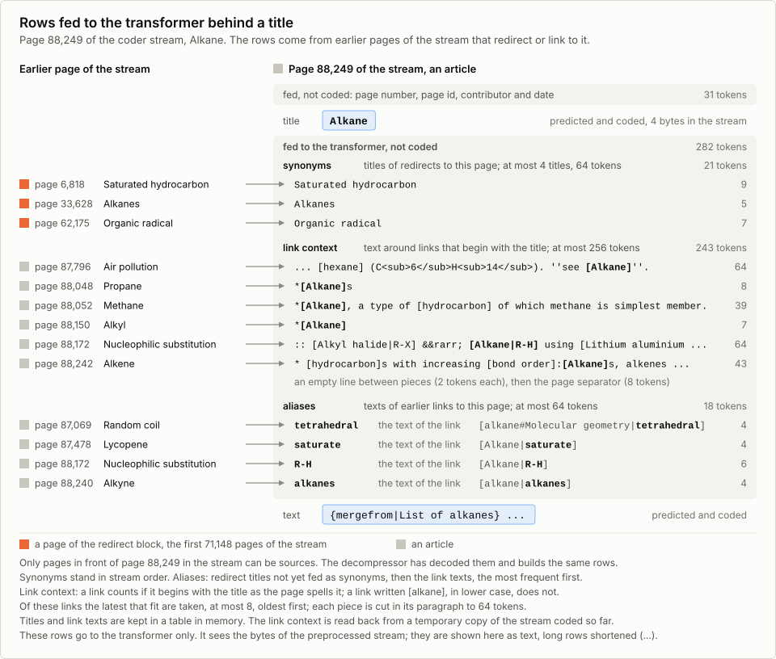
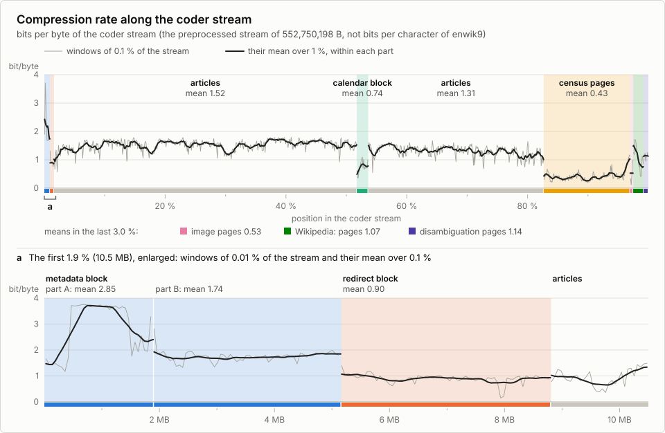
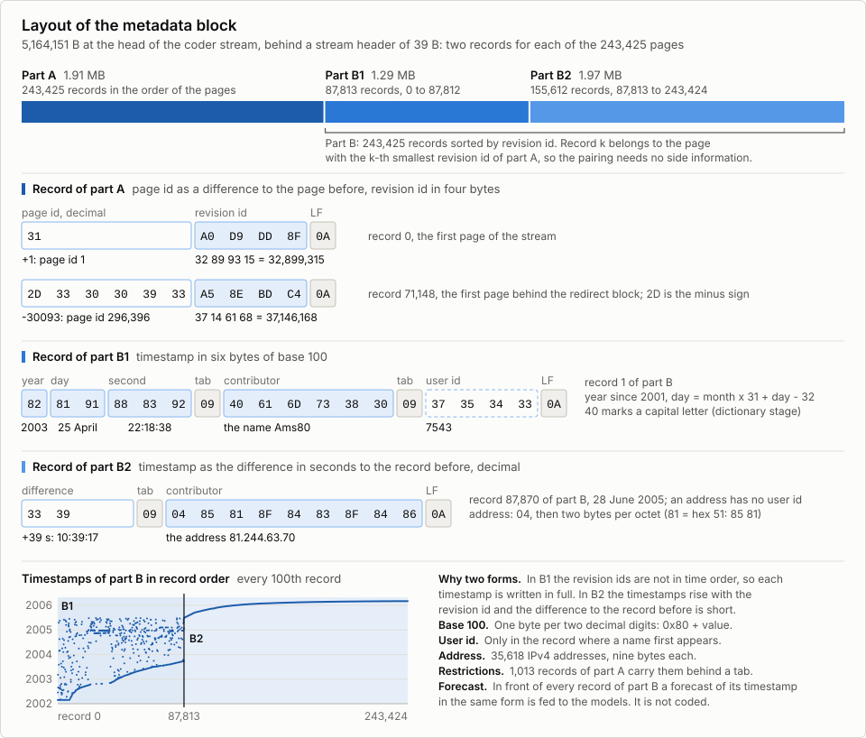
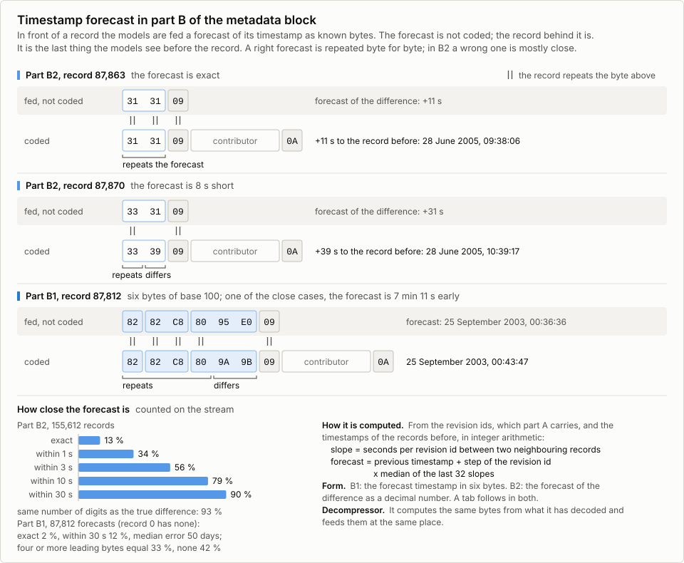

> **Ex-Girlfriend 1.0 (2026-10-10).** This is a modified version of cmix-neif 1.0 (Marcus Wölk). The text below is
> cmix-neif's own document, unchanged. The changes made after cmix-neif 1.0, their dates and their credits are in
> `EX-GIRLFRIEND.md`; the measured result of this version is there too.

# cmix-neif-1.0: a Hutter Prize entry

**Submitted by Marcus Wölk, Ellefeld, Germany.**

* Date of submission: 5 October 2026
* Name: cmix-neif-1.0
* Fork base: `cmix-lex`

This version is a continuation of `cmix-neif-pre3f`, which was submitted on
28 September 2026 from the same code base.

## The Hutter Prize

The **Hutter Prize for Lossless Compression of Human Knowledge** has run since
2006 and is funded by Professor Marcus Hutter. It rewards progress in
compressing `enwik9`, the first 10^9 bytes (1 GB) of the XML text dump of the
English Wikipedia of 3 March 2006. The contest began on the 100 MB file `enwik8`
with a fund of 50,000 euros; in 2020 both were raised tenfold, to `enwik9` and
500,000 euros, with 5,000 euros paid for each percent of improvement.

Its premise is that text compression and artificial intelligence are the same
problem. To compress text well a program has to predict it well, and to predict
it well it has to model the knowledge and the structure that the text
expresses, which is why the organizers describe compressing natural language as
an AI-hard task. The exact number of bytes a program needs to reproduce the text
is therefore taken as a measure of how well it models human knowledge, and the
contest exists to push that number down as a route towards general artificial
intelligence.

An entry must beat the current record by at least 1 % in `S`, the size of the
compressor plus the size of the self-extracting archive plus the length of any
command-line options needed for execution or compilation. Each program must run
on one CPU core without a GPU, within 70,000/T hours, where `T` is the
Geekbench 5 single-core score of the machine it is measured on, inside 10 GiB of
memory and using at most 100 GB of temporary disk.

* Rules and current record: <http://prize.hutter1.net/>
* Background: <https://en.wikipedia.org/wiki/Hutter_Prize>
* Announcements and discussion: <https://groups.google.com/g/Hutter-Prize>
* Large Text Compression Benchmark and further reading, Matt Mahoney:
  <http://mattmahoney.net/dc/text.html> and <http://mattmahoney.net/dc/>

## Result

| quantity | value |
|---|---:|
| `archive9`, self-extracting | 91,913,343 B |
| `comp9`, the compressor | 4,000,689 B |
| `comp9.args`, the command-line options of the compression run (`-e enwik9 archive9`, one per line) | 19 B |
| **S = `comp9` + `archive9` + `comp9.args`** | **95,914,051 B** |
| margin `(L-S)/L` | 4.49 % against the last awarded record, `fx2-cmix-transformer` (Vladimir Ivanov, submitted 24 July 2026, awarded 30 September 2026, L = 100,424,672 B); 3.42 % against `zmix 1.0` (James Byrne, submitted 14 September 2026, S = 99,312,424 B, unvalidated) and 3.42 % against `cmix-lex-transformer` lexth11c (Neel Patel, S = 99,313,750 B, not yet accepted), both pending at the time of this submission; 2.38 % against `cmix-neif-pre2` (S = 98,249,835 B) and 1.39 % against `cmix-neif-pre3f` (S = 97,262,944 B), the earlier submissions of this entry, both unpublished and not accepted at the time of this submission |
| wall clock | compression 48.72 h (measured in run 1 on the test machine, section 1.2), decompression 48.73 h |
| peak resident set | compression 9.75 GiB, decompression 9.75 GiB, measured in run 1 over the whole process tree as the Judging Assistant counts it |
| free disk | about 21 GB (section 1.1) |
| test machine | Google Cloud `c2d-highcpu-8` with one thread per core and a local NVMe SSD (section 1.2) |
| Geekbench 5 single core, `T` | 1,306 in run 1, limit 70,000/T = 53.60 h for each program; 1,289 in run 2, limit 54.31 h (section 1.2) |
| sha256 `comp9` / `archive9` | 8b07d85f0a374b55688fd08d1a464222f766efbb5bfefc2bc94d6abb201133d7 / 30eaf239168bd4efb4c57af09002b968308d7614d0cca619540e971fc38f4f18; both files can be downloaded (section 7) |

The transformer weights are a compressed container of 3,716,667 B. It is
appended to both executables and therefore counts twice in `S`; each program
writes it out of its own image at start-up (section 1.1). The weights of
BITLSTM, 7,386 B, are compiled into the program and count twice as well.

## Overview

`cmix-neif` is a fork of `cmix-lex` and keeps its architecture, with XML-aware
preprocessing, a word-replacing dictionary transform, a large bank of context
models mixed by a two-stage neural mixer, an arithmetic coder, and a
self-extracting archive.

Three groups of components were adopted from other entries of the 2026 round
and reworked for this entry.

1. **A pre-trained transformer byte model.** The idea and the inference engine
   come from **Vladimir Ivanov's `fx2-cmix-transformer`** (submitted 24 July
   2026). The online byte LSTM is replaced by a byte-level transformer that is
   trained offline on `enwik9` and shipped frozen. His engine is ported into
   `src/tf1/` file by file, 25 files in all; the coder-side driver was written
   for this entry after his `src/predictor.cpp` and takes from it his float16
   helpers, his error helper, float16 file writer and loss report, and his
   per-byte step; 10 further files of that directory are this entry's own. New
   in this entry are the vocabulary of 208 instead of 205 byte values, the layer
   count and the attention window as build constants, a model trained from
   scratch on this entry's own coder stream, the bfloat16 rounding of the
   unquantized tensors, two further container formats and the removal of dead
   neurons. His weights, his article-separator constant and his preprocessor are
   not used.
2. **BITLSTM, a small LSTM correction model** behind the mixer. The idea, its
   form, its AVX2 kernels, several of its input features and the approach of
   training it offline on a trace and shipping trained weights come from
   **David Freelan's `cmix-obias`** (published there as `bitlstm32`, submitted
   19 July 2026). It corrects the final probability additively in logit space.
   In this entry it has 16 cells, reads a subset of the stage-one mixer row and
   fixed sketches of the transformer and byte-LSTM states, is trained by a
   replay of the first 20 % of this entry's own compression run, and from 20 %
   of the stream on learns online at a tenth of the learning rate its offline
   training starts with. Section 4.4 describes it.
3. **Model and mixer mechanisms from `zmix 1.0` by James Byrne** (submitted
   14 September 2026): adaptive depth, which skips the
   mixer cascade on bits the model is sure about; indel recovery in the match
   model of the text model; an end-to-end gradient for the two-stage mixer; and
   a word-label model over the code words of the dictionary; together with four
   further items of the context maps and the secondary estimation. Each was
   ported from its Zig source or rewritten in C++ for this predictor, the indel
   recovery line by line (sections 3.3 and 3.4).

The transformer **takes the slot** of the byte LSTM of the fork base, which was
the largest single model of `cmix-lex`. A **small online byte LSTM** of 80 cells
with additional inputs stays beside it and feeds the mixer (section 4.10). It
uses part of the run time the transformer leaves within the limit. Its output
logits receive a PPMd prior, also taken from David Freelan's `cmix-obias`
(section 3.1).

The rest of the work is built around these components:

* the **page form of the stream**, which drops the constant XML markup, puts the
  title on the first line and the edit comment on the last, and collects the
  per-page metadata in a block at the head whose second half is sorted by
  revision id (section 4.9);
* the **prompt injection**, which feeds the transformer context that costs no
  archive bytes because the decoder can derive it (section 4.2);
* the **gate**, which keeps the metadata block away from the transformer (in
  training and in coding alike) and from BITLSTM, and the restart of the PPMd
  model behind the block (sections 4.3, 4.4 and 4.8);
* the **article order**, a modification of the article order of fx2-cmix
  (built by Byron Knoll with an embedding pipeline; inherited through cmix-lex
  in the revision of Kaido Orav's `fxcm_v26` archive), with the pages of its
  five end classes sorted by descending page id, the `Wikipedia:` pages moved
  from the end to between the image and the disambiguation pages, the redirect
  pages in front and the calendar pages as one block, shipped as a rule plus a
  small residual instead of a list (section 4.5);
* the **dictionary hints**, a compact package from which the compressor derives
  its dictionary, instead of shipping the full dictionary with the compressor
  (section 4.7);
* the exclusion model over page and revision identifiers, the comment index,
  the census transform, and the **frozen 208-value byte alphabet** (sections
  3.2, 4.6 and 4.9);
* the **PPMd model** with an order limit per context, paged by the program
  itself (section 4.8);
* the mixer and context-model work, the speed work that pays for the run time
  of the transformer, the memory work that keeps both programs under 10 GiB,
  and the packaging (sections 3.3 to 3.6).

## Contents

* [1. Quick start on a clean machine](#1-quick-start-on-a-clean-machine)
* [2. Lineage and attribution](#2-lineage-and-attribution)
* [3. Changes against cmix-lex](#3-changes-against-cmix-lex)
* [4. How the main components work](#4-how-the-main-components-work)
* [5. Training of the pre-trained parts](#5-training-of-the-pre-trained-parts)
* [6. Further optimisation opportunities](#6-further-optimisation-opportunities)
* [7. Files in this package](#7-files-in-this-package)
* [8. Closing remarks](#8-closing-remarks)
* [9. License](#9-license)

---

## 1. Quick start on a clean machine

### 1.1 Prerequisites

| item | requirement |
|---|---|
| platform | Linux, x86-64 |
| reproducible build | Ubuntu 24.04 LTS. `install.sh` installs clang, lld and llvm 18 (18.1.3) and the other build packages in the versions of the Ubuntu archive snapshot it names; with that package state the build reproduces the published `comp9` byte for byte. `install.sh` also runs on Ubuntu 22.04 LTS, where clang 18 comes from apt.llvm.org in a later 18.1 release; a build there was not tested and is not expected to be byte-identical. On other systems, install the tools listed in `install.sh` by hand and run `build.sh` |
| instruction set | **AVX2 and FMA required** (`x86-64-v3`). There is only this code path, and a build without AVX2 stops with an error |
| C++ toolchain | clang, lld and llvm, major version 18. Another major version produces a different binary |
| runtime | the shared libraries libc (GLIBC 2.34 or later), libstdc++ (GLIBCXX 3.4.29 or later), libm and libgcc_s; Ubuntu 24.04 provides them |
| RAM to run | the peak resident set stays below the 10 GiB the rules allow; the test machine has 16 GiB and no swap |
| RAM and disk to build | largest single process about 3.7 GiB, with the compile steps running in parallel (`make -j`); about 50 MB of disk, the unpacked package included; about 4 minutes on an AMD EPYC 7502P with 32 cores; the build does **not** need `enwik9`, the finished profile ships with the package |
| free disk to run | about 21 GB in the working directory, the larger of the two peaks of compression and decompression, counted by apparent file size (measured by the Judging Assistant, which sums the files of the working directory). The largest file is the page file of the PPMd model, 14,000 MiB apparent, written sparsely and removed at the end (section 4.8). In addition, unnamed temporary files are created with `tmpfile()`, which places them in `/tmp` whatever `TMPDIR` says. In one of them both programs keep a copy of the coder stream for the link context of the transformer, about 0.55 GB at the end of the stream. During its preprocessing step the compressor writes the pages and the metadata block to two more, 0.88 GB and 0.025 GB |
| input | `enwik9`, exactly 1,000,000,000 B, sha256 159b85351e5f76e60cbe32e04c677847a9ecba3adc79addab6f4c6c7aa3744bc |
| network | not needed after `install.sh`; the build is offline, and neither program opens a connection |

**Self-containment.** Apart from `enwik9` on the compression side, neither
program reads a file it did not write itself, except for its own image and the
two `/proc` entries named in section 1.5. Dictionary hints, article order and
the transformer weight container are appended blocks inside the executables,
and the weights of BITLSTM are part of the program. Each program
unpacks the blocks it needs from its own image at start-up into the current
working directory and checks a stamped fingerprint over the container bytes
before the model is used. `archive9` alone in an otherwise empty directory
decodes.

### 1.2 Run times

The compression was timed in three runs. Runs 1 and 2 used two instances of the
same Google Cloud machine type, run 1 outside and run 2 inside the Judging
Assistant; the third run was started directly on a rented dedicated server.

| machine | processor, memory, working directory | Geekbench 5 single core, `T` | limit 70,000/T | compression, wall clock | conditions |
|---|---|---:|---:|---:|---|
| Google Cloud `c2d-highcpu-8` with one thread per core, run 1, the test machine of the result table | AMD EPYC 7B13 (Zen 3), 4 cores, 16 GiB; local NVMe SSD, 375 GB | [1,306](https://browser.geekbench.com/v5/cpu/24681142) | 53.60 h | 48.72 h | outside the Judging Assistant, started directly on the instance in a cgroup with 16 GiB of memory and no swap like its container, with a cold page cache, pinned to one core |
| Google Cloud `c2d-highcpu-8` with one thread per core, run 2 | AMD EPYC 7B13 (Zen 3), 4 cores, 16 GiB; local NVMe SSD, 375 GB | [1,289](https://browser.geekbench.com/v5/cpu/24685263) | 54.31 h | 49.58 h | Judging Assistant (commit 2820606), serial, in its container with one CPU and 16 GiB |
| rented dedicated server | AMD Ryzen 9 5950X (Zen 3), 16 cores, 128 GiB DDR4; NVMe SSD | [1,707](https://browser.geekbench.com/v5/cpu/24665504) | 41.01 h | 39.35 h | started directly on the host, without the Judging Assistant, container or memory limit, pinned to one core |

In run 2 the Judging Assistant measured `T` itself with Geekbench 5.5.1 in its
container before the compression; the same value sets the limit of the
decompression. In run 1, `T` is the median of three runs of Geekbench 5.5.1
directly on the instance before the compression (1,301, 1,307 and 1,306). `T` of
the dedicated server was measured as in run 2, in a run of the Judging Assistant
(commit 4c3deb2) on that server on 25 September 2026.

The decompression runs the same models over the same coder stream as the
compression and takes about as long.

Run 2 can be repeated with the launcher of the Judging Assistant
(<https://github.com/jabowery/HutterPrizeJudgingAssistant>, commit
2820606). The entry directory holds the source package `cmix-neif-1.0.tar.gz` and
its `entry.env`, without `archive9`. The launcher then runs the Judging Assistant
in source-only mode, which builds `comp9` from the package, compresses `enwik9` and
afterwards decompresses the generated `archive9`, one program at a time.
`PROJECT_ID` stands for the Google Cloud project.

```
git clone https://github.com/jabowery/HutterPrizeJudgingAssistant.git
cd HutterPrizeJudgingAssistant
git checkout 2820606bc078b545bbeeb65f2b806670762af0af
./launch-cloud-judging.sh \
    --project PROJECT_ID \
    --instance-name hpja-c2d8 \
    --repo-ref 2820606bc078b545bbeeb65f2b806670762af0af \
    --machine-type c2d-highcpu-8 \
    --threads-per-core 1 \
    --local-ssd-nvme \
    --boot-disk-size 90GB \
    --region us-east1 \
    /path/to/entries/cmix-neif-1.0
```

With `--threads-per-core 1` the instance has 4 vCPUs on 4 physical cores and
16 GiB of memory. `--local-ssd-nvme` attaches one local NVMe SSD of 375 GB, which a
startup script formats and mounts as the working directory of the Judging
Assistant. The launcher creates the instance with this command (zone
`us-east1-b` in run 2; the path of the startup script is relative to
the repository root):

```
gcloud compute instances create hpja-c2d8 \
    --project=PROJECT_ID \
    --zone=us-east1-b \
    --machine-type=c2d-highcpu-8 \
    --boot-disk-size=90GB \
    --boot-disk-type=pd-ssd \
    --image-family=ubuntu-2404-lts-amd64 \
    --image-project=ubuntu-os-cloud \
    --provisioning-model=STANDARD \
    --maintenance-policy=MIGRATE \
    --no-service-account \
    --no-scopes \
    --metadata=block-project-ssh-keys=TRUE,serial-port-enable=FALSE \
    --shielded-secure-boot \
    --shielded-vtpm \
    --shielded-integrity-monitoring \
    --quiet \
    --threads-per-core=1 \
    --local-ssd=interface=NVME \
    --metadata-from-file=startup-script=cloud/mount-local-ssd-work.sh \
    --labels=purpose=hutter-prize-judging
```

The launcher then installs Docker and the other host tools, downloads `enwik9`
from <https://www.mattmahoney.net/dc/enwik9.zip>, checks its SHA-256 and starts the
Judging Assistant in a `tmux` session. At the end it prints the commands to attach
to that session, to copy the results and to delete the instance.

### 1.3 Build

```
tar xf cmix-neif-1.0.tar.gz
cd cmix-neif-1.0
bash install.sh
bash build.sh
```

The tarball can be downloaded (section 7) and contains exactly one top-level
directory, `cmix-neif-1.0`.

`install.sh` is the **only** step with root rights and network access. It
installs system packages and compiles nothing; it is non-interactive, and a
second run changes nothing.

`build.sh` runs **offline and without root**, in a copy of this directory. It
does the profile-guided compilation with link-time optimization, strips and
packs the binary with the self-extractor contained in this package, and appends
the build inputs. It writes `comp9` into the current working directory. Both
scripts exit non-zero on any failure and can be re-run. The build takes a few
minutes; the profile ships with the package, so no profile run is needed.

### 1.4 Compress

In a directory that contains `enwik9`:

```
./comp9 -e enwik9 archive9
```

The run takes 48.72 hours on the test machine of the result table (measured in
run 1 of section 1.2) and produces `archive9`.

Besides messages for its steps, such as the derivation of the dictionary or
the preprocessing of `enwik9`, the program prints a progress line in percent
about every 500,000 bytes of the coder stream. The run time is **not linear**
in that progress. On the test machine, in run 1 of section 1.2, one percent of
progress takes between 0.23 and 0.86 hours.

### 1.5 Decompress

Copy `archive9` into an empty directory and run it there:

```
mkdir out && cp archive9 out/ && cd out
./archive9
```

`archive9` takes no arguments. It writes `enwik9_uncompressed`, whose content is
identical to `enwik9` (`data9` in the Hutter Prize rules). The run takes 48.73
hours on the test machine of the result table. The console output resembles
that of the compressor.

Both programs read two files under `/proc`. `/proc/self/exe` is required,
because the packed image finds its own bytes through it; without it the program
stops at once with a non-zero status. `/proc/self/statm` sizes the page pool of
the PPMd model (section 4.8); if it cannot be read, the program prints one line
on stderr and the pool keeps its current size (2 GiB if `statm` is unreadable
from the start). The output is the same byte for byte in every case, but the
run can be slower.

### 1.6 Verify

```
cmp /path/to/enwik9 ./enwik9_uncompressed    # must print nothing
```

`S` is the size of `comp9` plus the size of `archive9` plus the 19 B of
`comp9.args`; the sha256 sums of `comp9` and `archive9` are in the result
table. While either program runs, `grep Threads /proc/<pid>/status` shows 1.

### 1.7 Determinism and the pinned build

The archive decodes only if the decompressor computes bit for bit the same
floating-point values as the compressor. This is secured as follows.

1. **One target instruction set.** Every unit is compiled with
   `-march=x86-64-v3`. There is no CPUID dispatch, because a second code path
   with a different vector width would change the order of floating-point
   accumulation and with it the archive. A compile-time check stops any build
   without AVX2 and FMA.
2. **Own transcendental functions** (`exp`, `log`, `exp2`, `tanh`, `pow`; for
   small arguments the eight-wide `tanh` of the byte LSTM uses the `tanhf`
   polynomial of the Cephes library). The results of the system maths library
   can change between glibc versions; a glibc update in 2025 changed `tanhf`
   and with it the archive of the same binary. The only transcendental
   function the unpacked image imports from the system maths library is
   `sincosf`; the transformer calls it only for positions beyond its rotary
   table of 131,072 entries, which the pieces fed to it do not reach.
3. **Fixed floating-point semantics.** Most units are compiled with
   `-ffp-model=fast -mrecip=none`; the numerically sensitive units, among them
   the transformer, BITLSTM and the adaptive-depth stage, with
   `-ffp-model=precise -ffp-contract=off`. `-Ofast` and `-ffast-math` are not
   passed, and no `crtfastmath` object is linked, so flush-to-zero and
   denormals-are-zero stay off as the ABI sets them at process start.
4. **No reciprocal estimates.** Approximate reciprocal instructions differ
   between CPU generations and are excluded by `-mrecip=none` and by the precise
   units. The unpacked image was checked for `rcpps`, `rsqrtps`, `vrcp*` and
   `vrsqrt*` before release.
5. **Single thread, fixed seeds.** Both programs run on one thread. Every model
   that draws random numbers uses a fixed seed compiled into the binary.

The profile of the profile-guided build ships in `pgo_data/`, so a build from
this package with the pinned toolchain produces the `comp9` whose sha256 is in
the result table, also on other machines (section 9). A different compiler can
produce a `comp9` of slightly different size and a slightly different
`archive9`. The submitted `archive9` is self-contained and decodes however it
was built.

### 1.8 Self-extraction

Both executables are packed with the self-extractor in `tools_src/packer/`,
which `build.sh` builds offline. At start the stub unpacks the program into an
anonymous memory file and starts it (`memfd_create`, `execveat`). Without
`memfd_create` it writes the program to `./.b5c_run` or `/tmp/.b5cstub`, starts
it from there and leaves that file in place.

Each program starts its own image again through the C library's `system()`,
which runs a shell, to decode embedded blocks (mode `-D`) and, in the
compressor, to code the derived dictionary (mode `-C`); the build uses the
modes `-h` and, without a shipped profile, `-c`. Apart from that shell, neither
program starts a program other than its own image. Because of these child
processes, the entry needs the `process-tree` execution policy of the Judging
Assistant.

---

## 2. Lineage and attribution

```
cmix                                  Byron Knoll
  -> STARLIT                          Artemiy Margaritov  (Hutter Prize 2021)
     -> cmix-hp                       Byron Knoll
        -> fast-cmix                  Saurabh Kumar       (Hutter Prize 2023)
           -> fx-cmix                 Kaido Orav          (Hutter Prize 2024)
              -> fx2-cmix             Kaido Orav, Byron Knoll  (Hutter Prize 2024)
                 -> cmix-lex          Ibrahim Marcouch    (Hutter Prize 2026, awarded to
                                                           Ibrahim Marcouch and Kaido Orav;
                                                           immediate fork base)
                    -> cmix-neif      (this entry, 2026)

text model from fx-cmix on, in place of paq8hp: fxcm (Kaido Orav);
in cmix-lex its version fxcm_v26
```

Four published entries of the 2026 round feed into this one directly;
`fx2-cmix-transformer` and `cmix-obias` were awarded on 30 September 2026.

* **`fx2-cmix-transformer` (Vladimir Ivanov)**,
  `github.com/astOwOlfo/fx2-cmix-transformer-v1` (linked from the Large Text
  Compression Benchmark entry of that name), GPL-3: the transformer inference
  engine (25 files in `src/tf1/` and parts of the coder-side driver), its layer
  pattern and container formats v1 and v2, and the training code, which ships
  unchanged in `training/tf/tree_upstream/` and from which the training form in
  `training/tf/tree_overlay/` and the export tools are derived.
* **`cmix-obias` (David Freelan)**, `huggingface.co/dfreelan/cmix-obias`,
  revision `51488a0c`, GPL-3: BITLSTM, the PPMd prior on the output logits of
  the byte LSTM (in the form of its constant-weight build) and the zero-state
  masking in the branch-free evaluation of the context-map states.
* **`zmix 1.0` (James Byrne)**, `zmix.frostbyrne.io/v1.0/zmix-src.tar.gz`,
  GPL-3.0-or-later: the four mechanisms and four further items listed in
  sections 3.3 and 3.4, ported from its Zig source or rewritten in C++ here.
* **`fx-deepmix` (Halvor Yttredal)**,
  `mattmahoney.net/dc/fx-deepmix-source.zip`, GPL-3: one ported model, the form
  in which the feed of the byte-model prediction into the text model (Kaido
  Orav's wiring from `fx2-cmix`) is restored, and the value 0.1 of the final
  step of the mixer learning-rate schedule.

Further published work:

* **Layth Lakhani's** experiments on `fx3-cmix`
  (`github.com/IntrepidEnki/fx3-cmix-submission`; `fx3-cmix` itself is Kaido
  Orav's project): two memory ideas (narrower index types, a larger shared
  map).
* **Seth Lupo's** public `fx3-cmix` experiments
  (`github.com/Seth-Lupo/fx3-cmix`): the question of the widths of the direct
  state maps, which those experiments made smaller.
* **Rohit Dwivedula** (`github.com/rohitdwivedula/fx2-cmix`, commit
  `468e92b9`): an SSE2 search for check values in the context maps (its
  compare in the form of that commit, extended to 16 slots) and the reuse of
  the last context lookup in the mixer (in the structure of that commit), both
  rewritten and measured here, and the header inlining of `Sigmoid::Logit` and
  `MixerInput::Set*`; the four `Set*` functions are taken over in the form of
  that commit.

Older ancestry inside the tree:

* **Kaido Orav**: `fx-cmix`, `fx2-cmix`, the text model `fxcm` in its version
  `fxcm_v26` in `src/models/fxcmv1.cpp`, which **Ibrahim Marcouch** integrated
  into the cmix predictor for `cmix-lex`, and the fine clusters of the
  dictionary.
* **Byron Knoll** and **Kaido Orav**: the article order of `fx2-cmix`, which
  this entry's order modifies. Byron Knoll built its embedding pipeline and its
  manual sort step, whose page classes and detection strings the order rule of
  this entry uses; the revision inherited through `cmix-lex` comes from Kaido
  Orav's `fxcm_v26` archive, in which the `Wikipedia:` pages form one block at
  the end.
* **STARLIT** (Artemiy Margaritov): the idea of reordering articles and the
  inherited code in `src/readalike_prepr/` that reorders the articles, sorts
  them back by page id, splits the input and embeds dictionary and order in
  the executable.
* **phda9** (Alexander Rhatushnyak): Wikipedia preprocessing and the metadata
  block.
* the **paq8** line (Matt Mahoney, Alexander Rhatushnyak, Przemysław Skibiński
  and others): word replacement and state tables.
* **paq8px** (begun by Jan Ondrus): in the text model the English stemmer
  after Martin Porter's Porter2 algorithm (**Márcio Pais**) and the second
  match model, based on paq8px v208 (**Márcio Pais**, **Zoltán Gotthardt**).
* `paq7` (**Matt Mahoney**, GPL): the squash function, the inverse stretch
  table, the binary arithmetic coder and the APM form of the self-extractor's
  decoder.
* **PPMd** (Dmitry Shkarin) with `mod_ppmd` and the SSE stage (Eugene
  Shelwien).
* **Byron Knoll**'s `cmix-hp` and **Saurabh Kumar**'s `fast-cmix` (2023),
  between STARLIT and `fx-cmix`, which brought the hash maps and the containers
  of `src/ds/` into the line.

From outside the program family:

* the stretch curve ln(p^k / (1 - p^z)) with z = -log2(1 - 2^-k), posted by
  the contributor **mpais** on encode.su (thread 4534, "Research ideas", post
  88828, 26 August 2026) as a confidence-dependent stretch; used here with a
  fixed k of 0.75, mirrored at p = 0.5, in the stretch table that turns the
  state probabilities of the context maps into mixer inputs;
* the word-label model's two sources as cited by `zmix`: the log-bilinear
  language model of **Mnih and Hinton** (2007) and the hierarchical softmax of
  **Morin and Bengio** (2005);
* the block-diagonal recurrence of the small byte LSTM, in the form published
  by **Xeloraa** (`github.com/Xeloraa/Hutter-compression-research`),
  implemented and measured here;
* the type of the linear-attention layers of the transformer, Kimi Delta
  Attention from Kimi Linear (the **Kimi Team**, arXiv 2510.26692), as cited in
  Ivanov's writeup; his C++ form of these layers reproduces the semantics of
  the kernels of `flash-linear-attention` (**Songlin Yang, Yu Zhang, Zhiyuan
  Li**, MIT);
* for the training of the transformer, through Ivanov's trainer, the Muon
  optimizer (**Keller Jordan** and co-authors) and the further published
  techniques listed in section 4.2 of `training/ATTRIBUTION.md`;
* for ordering bands 3 and 4 of the dictionary offline, the pre-trained
  embedding models `intfloat/e5-large-v2` and `BAAI/bge-reranker-base` (MIT);
  nothing of them ships;
* in Ivanov's container code, his bit-exact port of the single-precision sine
  and cosine of NVIDIA's CUDA libdevice, with which the rotary tables are
  recomputed, and a range coder in the form of the LZMA SDK (**Igor Pavlov**,
  public domain), with 11-bit probabilities and adaptation shift 5;
* for the self-extracting stub, the idea of the x86 BCJ filter of the LZMA SDK
  (**Igor Pavlov**), which its address transform extends, and the principle of
  Crinkler (**Rune L. H. Stubbe**, **Aske Simon Christensen**), a
  context-mixing decoder in a small executable stub (section 3.6);
* polynomials of the Cephes library (**Stephen L. Moshier**) in the vector
  `exp` and `log` of the transformer engine, in `Exp8` of BITLSTM and in the
  eight-wide `tanh` of the byte LSTM; `Exp8` and the vector `exp` and `log` of
  the engine are altered versions of `exp256_ps` and `log256_ps` of
  `avx_mathfun.h` (**Giovanni Garberoglio**), which is based on `sse_mathfun.h`
  (**Julien Pommier**), zlib licence;
* the civil-date conversion of the timestamps, **Howard Hinnant**'s
  public-domain `days_from_civil` and `civil_from_days`;
* division by run-time constants through a magic multiplier, the method of
  **T. Granlund and P. L. Montgomery** (1994) in the form of `magicu` from
  *Hacker's Delight* by **Henry S. Warren, Jr.**;
* one xor-shift and multiply step with the multiplier `0x85ebca6b` of the
  MurmurHash3 finalizer (**Austin Appleby**, public domain) in the check-value
  hash of the compact context maps, and the primes and the first avalanche
  steps of xxHash32 (**Yann Collet**, BSD-2-Clause) in the context hash of the
  packer and in the pair and triple hashes of the small byte LSTM, and parts of
  xxHash32 in two helpers that the program does not call;
* the hash scheme FNV-1a (**Glenn Fowler, Landon Curt Noll, Kiem-Phong Vo**,
  public domain) for titles, aliases, dictionary words, the order rule and the
  check of the weight container;
* the generator splitmix64 (**Sebastiano Vigna**, public-domain reference code,
  after Steele, Lea and Flood) for the fixed random projections and the initial
  weights of BITLSTM and its trainer, and two of its constants in the hash of
  the word-label model;
* in the deterministic `exp` and `log` of `src/detmath.cpp`, the split of ln 2
  into a high and a low part and two further constants, written as in
  **fdlibm** (Sun Microsystems); the functions themselves are series of this
  entry.

Embedded third-party components, all GPL-3 compatible: inherited with the fork
base, the `emhash` map and set (Huang Yuanbing, MIT) and LLVM `SmallVector` and
`AlignOf` (Apache-2.0 with LLVM exception, and NCSA; both in PyTorch's `c10`
form, whose changes are BSD-3-Clause), all three of which reached the line
through `fast-cmix`; and, from the list above, the altered `avx_mathfun.h`
routines (zlib) and the parts of xxHash32 (BSD-2-Clause). The unchanged upstream
tree in `training/tf/tree_upstream/` carries the same three libraries and the
same `avx_mathfun.h` routines. The license texts of these components ship in
`third_party/`, whose `README.md` says what each one covers. `NOTICE.md` names
the authors of the borrowed parts individually, and it names the terms of
`prof_input/`. That directory
holds two Wikipedia excerpts under the GNU Free Documentation License
and the Creative Commons Attribution-ShareAlike licence; the build reads one of
them only when `pgo_data/` holds no profile, and not one of their bytes reaches
the compressed archive. `tools_src/sstrip.c` is an independent implementation
written for this entry (GPL-3.0-only); its header says so. The name follows
Brian Raiter's `sstrip` from the ELF kickers package, but no code of that
program is used. The build chain prefers `llvm-objcopy --strip-sections` and
falls back to this helper only where that is unavailable.

`training/ATTRIBUTION.md` is the detailed register, file by file, with commits
and URLs, and with the distinction between borrowed code and borrowed ideas. It
covers the compressor as well as the training tools. No copyright claim is made
over inherited code.

If I have listed anything wrongly or overlooked a contribution in this section,
in `NOTICE.md` or in `training/ATTRIBUTION.md`, please feel free to open an
issue in the GitHub repository of this entry
(<https://github.com/marwoelk/cmix-neif-1.0/issues>).

---

## 3. Changes against `cmix-lex`

Negative numbers mean smaller or faster. All figures are approximate. They come
from stream prefixes of 20 to 100 MB, from partial windows and from full runs,
from different stages of development, and no item was measured against every
combination of the others. Combinations were repeatedly sub-additive, so **the
sum of these tables is not the difference between `cmix-lex` and this entry**;
that difference is the result table. Where a row says "estimate", the figure
was extrapolated from a shorter stream or computed instead of measured; "at
N %" means a full run read at that share of the stream.

Code and data that both programs need are in the compressor **and** in the
embedded decompressor and therefore count twice in `S`; this includes the
transformer weight container and the weights of BITLSTM. Build
inputs that only the compressor needs, such as the dictionary hints and the
article-order residual, count once. Each size cell says whether it refers to
`archive9` (the coded payload), to the binaries, or to `S`.

Time figures were measured during development on several machines (AMD Zen 2
and Zen 3, Intel Core i9), partly as wall clock and partly as instruction counts
with `perf`. They show the order of magnitude and depend on the CPU.

The comment column names the origin wherever an idea or a piece of code came
from somewhere else, wholly or in part. Everything without such a note was
designed and implemented for this entry, apart from the methods from the
literature named in section 2. Numerous small changes (renamings,
simplifications, error handling, console messages, removal of unused code,
small run-time and memory improvements) are not listed one by one.

### 3.1 The byte model

| item | what it does | size effect | time / RAM | comment |
|---|---|---|---|---|
| pre-trained transformer | frozen byte-level transformer in the byte-model slot, in place of the online byte LSTM; 16 layers (12 linear-attention layers and 4 attention layers over a window), d_model 192, about 7.8 M parameters, weights quantized to 4 bits, activations to 8 bits, AVX2 integer kernels | several MB on `archive9` (about -6 MB measured with a first, smaller proof-of-concept model against the online LSTM it replaces); its weight container of 3,716,667 B counts twice against that | the largest time item (about 44 % of the run time with an earlier, smaller model of 12 layers and about 6 M parameters; not measured for this model) | idea and inference engine **taken from Vladimir Ivanov, `fx2-cmix-transformer`**, including the layer pattern; the linear-attention layers are of the Kimi Delta Attention type of Kimi Linear (**Kimi Team**); section 4.1 |
| attention window 2048 | the window of the attention layers is a build constant and part of the training form | five windows from 1024 to 3072 compared in full runs (section 4.1); against 1024, the window 2048 was about -49 KB and 2560 about -61 KB at 39 % of the stream; 3072 was about 10 KB behind 2560 at 34 % | 2560 instead of 2048 about +5.5 % instructions, 3072 about +10.4 % (counted with the smaller model, which has three attention layers instead of four) | 2560 gave the smallest archive; 2048 was chosen for run time |
| prompt injection | page number, page id, contributor and date in front of the title, redirect synonyms, incoming link context, earlier link texts for the same target, section heading with the article title, the contributor in front of the comment line and digit-run length classes, fed to the transformer and never coded, because the decoder can derive them | measured only together with a better trained model; no separate figure | injected rows take places in the attention window and cost inference time | section 4.2 |
| gate | the metadata block is kept away from the transformer in training and in coding; 0.93 % of the coder stream | not measured on a full run | small | section 4.3 |
| gate bit as mixer context | the mixer can weight the transformer differently inside and outside the gated block | contained in the model figures | negligible | |
| redirect runs as one document | a run of redirect pages and the page that follows it form one transformer document, so the context is not reset between them, and between their pages only the page rows (with the redirect row) and any alias rows are inserted, no synonyms, link context or heading reminders; in training and in coding | contained in the model figures | negligible | a change requires retraining |
| side channels and input packing | the two preceding fed tokens, the match model's predicted byte and a coarse match-length class, packed in the training data into one 64-bit word per row; extra embedding rows for the sentinel alphabet and a no-predecessor mark | contained in the model figures | negligible | designed for this entry, on his engine |
| bfloat16 rounding and counting container | the tensors his design leaves unquantized are rounded to bfloat16 before packing (a lossy change, accepted after a rate measurement on the smaller model); the three stationary bit trees of the container's range coder count instead of decaying | together -115,514 B per container, counted twice; no measurable rate cost of the rounding on a 20 MB prefix | none | the container format, its range coder (in the form of the LZMA range coder of **Igor Pavlov**) and the recomputation of the rotary tables (his bit-exact port of the sine and cosine of NVIDIA's CUDA libdevice) are Ivanov's; section 4.1 |
| dead neurons removed | MLP neurons whose quantized output is zero for every possible input are removed from the container (70 of 12,288) | -10,961 B per container (-21,922 B of `S` before about 0.2 KB of code); the archive does not change | none | the decision is a closed bound computed from the container (no sampling) |
| container format v4 | zero byte planes and all-zero rows cost almost nothing, tensor names and shapes follow a template; 86 rows of collapsed attention channels are set to zero before | -10,301 B per container, -19,320 B of `S` net of code | none | with the rows zeroed, the archive was byte-identical on two test beds |
| stamped binding | a fingerprint of the container is stamped into the source and checked at load time | several tens of KB of `S`, because the packed binary shrinks | none | |
| integer attention kernel | the product of attention weights and values in the windowed layers runs in integers | in the noise on 20 MB prefixes | about -5.9 % instructions (measured with the smaller model) | |
| BITLSTM | small LSTM behind the mixer that corrects the final probability additively in logit space, immediately before the arithmetic coder; 16 cells, inputs listed in section 4.4; weights trained offline on the first 20 % of the stream and compiled into the program; learns online from there | at 20 % of a full run, where the run is still the same as with frozen weights, about -65 KB on `archive9` against no BITLSTM and about -20 KB against an online BITLSTM of 32 cells without trained weights; over the whole stream about -44 KB on `archive9` and about -32 KB of `S`, where the weights count twice, against that online BITLSTM (full runs; the comparison run also differs in five further settings, which made the run of this entry about 1 KB larger at 58 %), and about -0.3 MB on `archive9` against no BITLSTM (estimate from a full run read at 32 %) | about +3 to +4 % of the run time against no BITLSTM (estimate from two compression runs compared up to 33 % of the stream on Zen 3 cloud instances, with an online BITLSTM of 16 cells and without the small byte LSTM); learning online from 20 % on costs at most about 1 % of the run time against weights kept frozen, within the spread of these runs | idea, form, AVX2 kernels, several input features and the offline training on a trace **taken from David Freelan, `cmix-obias`** (published there as `bitlstm32`); section 4.4 |
| small byte LSTM | beside the transformer, an online byte LSTM of 80 cells takes the place of the large one (170 cells in cmix-lex) and feeds the layer-0 mixer, the final mixer and BITLSTM; its recurrence is block-diagonal in blocks of 16 cells | removing it costs about 12 KB at 30 % of a full run without BITLSTM (a figure that also contains a change of the transformer's place in the mixer) | about +8 % for 64 cells, roughly one more hour for each further 16 cells; the block-diagonal recurrence about -0.4 % instructions | the block-diagonal recurrence follows the form published by **Xeloraa**; section 4.10 |
| inputs of the small byte LSTM | besides the PPMd distribution of the next byte: a hash of the last two bytes (4,096 buckets) and of the last three bytes (16,384 buckets) and the byte predicted by the longest match, as sparse one-hot inputs with their own weights; the coding cost of each bit of the previous byte minus its running average, as eight dense inputs | about -50 KB for the hashed pairs and triples, about -5 KB for the match byte and about -6 KB for the cost inputs, on 80 MB windows of an earlier configuration with a larger byte LSTM and no transformer; not isolated in this build | about +1.6 % instructions for the pairs and triples (same measurement) | |
| PPMd prior on the byte LSTM | at every byte boundary the output logits of the byte LSTM receive the PPMd log-probabilities of the next byte, scaled by a fixed factor of 0.55 (`src/ppm_logit_prior.h`); the LSTM therefore learns a correction to the PPMd prediction | about -19 KB on an 80 MB prefix, measured with a larger byte LSTM; not isolated in this build | none | **taken from David Freelan, `cmix-obias`**, in the form of its constant-weight build (there the weight is learned or a constant); the bias g ln(max(p, 1e-6)) and the hook that adds it to the output logits before the softmax follow his code, and the factor 0.55 was chosen here |

**Final configuration.** A transformer of 16 layers at d_model 192, about 7.8 M
parameters, attention window 2048, trained on this entry's own coder stream
for 1,000 epochs in bfloat16, 32 epochs quantization-aware and 6 at full
precision; beside it a small online byte LSTM of 80 cells, feeding the layer-0
mixer, the final mixer and BITLSTM; and BITLSTM with 16 cells, starting from
weights trained offline, frozen for the first 20 % of the stream and learning
online from there at a learning rate of 0.0003.

### 3.2 Stream and preprocessing

Preprocessing turns the 1,000,000,000 B of `enwik9` into a coder stream of
552,750,198 B over exactly 208 distinct byte values. The decompressor reverses
every item from the stream alone unless the row says otherwise.

| item | what it does | size effect | time / RAM | comment |
|---|---|---|---|---|
| page classes sorted by page id | inside each of the five page classes that the base order places at the end (census, image, disambiguation, geographic and personal-name disambiguation pages), the pages are sorted by descending page id | about -12 KB on the payload (full run of an early configuration with an explicit order list; that order also moved the `Wikipedia:` pages from the end into the normal part, see the next row) | none | the classes and their detection strings are Byron Knoll's; the order inside the classes costs no residual symbols (section 4.5) |
| `Wikipedia:` block | the block of `Wikipedia:` pages, which the inherited order places last, stands behind the census and image pages and in front of the disambiguation pages | about -10 KB of `S` against the order of the previous row, which had these pages in the normal part (full run of an early configuration); against their place at the end not isolated | none | the block at the end is **Kaido Orav's** (his `fxcm_v26` revision of the order; the README of his `fx3-cmix` notes a move of these pages, "Moved all articles with title 'Wikipedia:' after images"); its place in front of the disambiguation pages is this entry's |
| redirect pages in front | the block of redirect pages moves to the front of the article order instead of the end | costs about 90 KB of `S` on its own (full run with an earlier model), 0 B of side information | none | it is kept because the redirect and synonym prompts and the alias rows depend on it (section 4.5); their gain was not separated from the model change |
| calendar block | pages whose title is a year, decade, century, millennium, day, month, month of a year or a list of deaths of a year (3,417 pages) leave the rank-coded part of the order and form one block, sorted by a key computed from the title | together with the retuned rule below -2,055 B of `S` (smaller residual, package form); the effect on the payload was not isolated | none | membership and inner order cost no side information |
| order as a rule plus residual | the article order is shipped as a small residual file (115,870 B, 43,780 B compressed), not as a list of article numbers; the rule takes links and content words from the first 600 characters of each article | about -100 KB of `S` against a list (an earlier measurement) | none | carried in the compressor only; the decompressor needs no order information. The encoded order is a modification of the **fx2-cmix** article order (built by **Byron Knoll**; inherited through cmix-lex in the revision of **Kaido Orav's** `fxcm_v26` archive); the page classes the rule places at the end and the strings that detect them are taken from Byron Knoll's manual sort step of that pipeline (`src/article_order/manual-sort.ipynb` in fx2-cmix); the idea of reordering articles and the inherited reordering code are STARLIT's (**Artemiy Margaritov**) |
| dictionary hints | the word dictionary is derived at run time from `enwik9` and a compact hint package (205,067 B, about 57 KB compressed) instead of being shipped | about -50 KB of `S` | about a minute | integer arithmetic, bit-identical across machines. The decompressor has no `enwik9` and gets the compressed dictionary inside the archive |
| dictionary | larger dictionary (54,857 entries, 520,804 B), an extra code band, reordered bands 3 and 4 | measured before the transformer, in two steps: 44,880 entries in a new word order about -106 KB of `S` against the dictionary of cmix-lex (33 pieces that together cover the stream, each coded on its own); from there to this dictionary about -19 KB on the payload, about +29 KB for the compressed dictionary in the archive and about +25 KB for the hint package of that time, about 19 KB larger than the present one (full run); not isolated with the transformer | the second step shortens the stream by about 2.0 MB | built on the word set of the paq8hp series, inherited through the cmix line; its macro bands come from paq8hp and its 510 fine clusters are **Kaido Orav's**. The extension and the reordering of bands 3 and 4 (offline, with k-means and pre-trained embedding models; `training/data/README.md` section 1) were done for this entry |
| census transform | derivable numbers of the machine-generated place articles (population, areas, densities, housing, coordinates, the last share of a sum of 100 %) are recomputed by the decompressor instead of being coded | base rules not isolated on a full run; two later sets of refined rules: about -64 KB on the payload in the census region of a full-run pair that also differed in other items, and about -29 KB (full run); both before the transformer | shortens the stream by about 1 MB (base rules); the transform itself about a second | |
| comment index | an edit comment that starts with a section reference loses it; a mark line after the page text carries the index of the page heading of that name, or the name itself | roughly -50 KB (estimate) | small | |
| language links folded in | the language links at the end of an article stay in the article; the inherited phda9 preprocessing of cmix-lex moves them into a separate block at the end of the stream | about -40 KB on an 80 MB window, more on the full stream (estimate) | none | |
| page form without XML | a page becomes title line, body, edit comment line, a last line with `minor` as a word where the revision was marked minor, one separator; the constant XML markup is not coded and the decompressor writes it back | within the noise of an 80 MB measurement | shortens the coder stream by about 17.5 MB, about -1.1 h (computed from the stream length) | the gain is time and model context, not rate; section 4.9 |
| metadata block at the head, split and sorted | page id, revision id, timestamp and contributor go into one block at the head of the stream; part A (page id as a delta, revision id, restrictions where present) in stream order, part B (timestamp, contributor) sorted by revision id, paired by rank | about -62 KB on the block for the split and the sort | shortens the stream by about 4.9 MB, about -0.3 h (computed) | the block itself is **Alexander Rhatushnyak's (phda9)**, inherited through the cmix line; its place at the head, the split, the sort and the field forms below are new in cmix-neif; section 4.9 |
| field forms of the block | revision ids as four bytes of digit pairs; timestamps as six such bytes below a fixed rank and as a difference to the predecessor above it; the 35,618 addresses of anonymous edits packed to two bytes per octet behind a hint byte | about -20 KB on a 20 MB prefix (measured with an earlier model set); the address packing alone about -3.6 KB on the block | shortens the stream by about 3.0 MB | |
| timestamp forecast | in front of every record of part B, a forecast of its timestamp, computed from the revision ids, is fed to all models as known bytes | about -45 KB on the metadata block coded alone | small | no archive bytes |
| user id at the first mention | the user id of a contributor is coded only where the name first appears | about -0.8 KB on the block; the stream gets 1.1 MB shorter | about -12 % instructions on the block | |
| contributor fed at the page | in front of the comment line of each page, its contributor and a tab are fed to all models as known bytes, and the transformer receives them as a prompt row; a marker byte opens the comment line | about -8.8 KB on a 20 MB window | about +0.2 % instructions | the marker adds 190,325 B to the stream and no symbol to the alphabet |
| redirect mark as code | in the front block of redirect pages, the mark `#REDIRECT` is dropped (60,683 pages) and the spellings `#redirect`, `#Redirect` and `{{softredirect` each become one code character (10,424 pages); the decompressor restores the mark from the first byte of the page text | about -0.8 KB on the redirect block of a 40 MB prefix, measured without the transformer | shortens the stream by 263,648 B | |
| exclusion model over the identifiers | page ids and revision ids never repeat and often come in ascending runs; a model excludes digits that are no longer possible, passes the result to the mixer and, where the remaining values fix the bit, sets the final probability to its bound | about -9 KB on the metadata block (measured on the earlier decimal form of the block) | about half a minute per run (computed from instruction counts), about 15 MB RAM, no extra mixer column | |
| HTML entity as control byte | the HTML entity `&sup2;` of the page text (332,016 occurrences) is mapped to a free control byte | about -41 KB (full run) | shortens the stream by about 1.0 MB | extends the entity mapping of the inherited phda9 transforms (**Alexander Rhatushnyak**), which **Kaido Orav** extended in `fx2-cmix` by further entities |
| frozen 208-value byte set | the alphabet of the coder stream is frozen and stamped as a bitmap, and the models allocate for 208 instead of 256 symbols | about -4 KB on an 80 MB prefix, about -2 KB of binary | about -4 % instructions | section 4.6 |

### 3.3 Mixer and context models

| item | what it does | size effect | time / RAM | comment |
|---|---|---|---|---|
| second match channel | a match channel anchored in the parser state instead of raw history | about -26 KB on the payload (full run) | time-neutral | **line-by-line port from Halvor Yttredal, `fx-deepmix`** |
| indel recovery in the match model | when a match of the text model's match model fails, it re-anchors at offsets of one and two bytes and keeps its backup for up to three byte boundaries | about -4.3 KB on an 80 MB window | about +0.5 % cycles | **ported line by line from `zmix 1.0`** (its Zig source) |
| end-to-end mixer gradient | the layer-0 mixers learn from their exact share in the error of the final mixer instead of their own local error; the final mixer starts as a plain average | about -10.1 KB on an 80 MB window | about +0.1 h (estimate) | **mechanism taken from `zmix 1.0`**; its backward recursion is rewritten in C++ from the Zig source |
| word-label model | an online log-bilinear model over the 16 preceding words predicts the bits of the next dictionary code word through a hierarchical softmax over the code-word tree; one layer-0 mixer input | about -4.3 KB on an 80 MB window (estimate for the whole stream -6 to -14 KB); about -2.7 KB at 13.6 % of a full run, where the comparison run was stopped | about +0.05 h (estimate), about +69 MiB (computed from the table sizes) | **ported from `zmix 1.0`** (its Zig source, the tied-decay form, transferred function by function to C++) together with its hyper-parameters; `zmix` cites Mnih and Hinton (2007) and Morin and Bengio (2005); extended here to the fourth code-word band of this dictionary |
| direct-state-map widths | the bit widths of four of the five direct state maps of the text model | about -39 KB on the payload (full run) | +367 MiB RAM | the same maps were made smaller in Seth Lupo's public `fx3-cmix` experiments (`github.com/Seth-Lupo/fx3-cmix`, linked on encode.su); the larger widths here were measured for this entry |
| mixer learning rates | layer-0 mixers at 1.3 times and the final mixer at 0.75 times the inherited rate; the last step of the schedule at 0.1 | the level 0.75 for all mixers about -33 KB and the last step about -46 KB (full runs with an earlier model); raising the layer-0 mixers to 1.3 about -6.4 KB at 41 % of a full run (with a different final-mixer rate) | none | the value 0.1 of the last step is **Halvor Yttredal's, `fx-deepmix`** |
| schedule restart after the metadata block | the learning-rate schedule of the mixers starts again at the first page, so the text is not coded on the last step of a schedule that the metadata block has run through | about -2.1 KB on a 20 MB window | none | |
| context-map capacities | 16 context-map capacities of tiers 0 and 1 doubled; a seventeenth map of that group carries no context in this stream form and was made smaller instead | about -5 KB (full run, measured with all 17 maps doubled) | +148 MiB RAM | the sign depends on the rest of the set |
| compact context-map buckets | one family of context maps of the text model stores 16 instead of 14 slots per 128-byte bucket (11 slots of 5 bytes for the contexts at the byte boundary, 5 of 7 bytes for those at bit positions 2 and 5), with a hashed 11-bit check value and a 6-bit use counter that decides which slot is replaced; several maps of the family are made smaller; the four most recently used slots of a bucket are protected from replacement (two before), and a replacement no longer empties that queue | about +10 to 13 KB on the payload against full-size maps (estimate from a full run read at 69 %); the recency protection alone about -52 KB in an earlier full run | about -2 GiB RAM | the first mixing stage of the check-value hash follows an option of **`zmix 1.0`**, its second stage is one xor-shift and multiply step with the multiplier of the MurmurHash3 finalizer (**Austin Appleby**, public domain); the memory goes to the PPMd page pool (section 4.8) |
| context-map time constant | the time constant of an average in one context-map family is raised | about -0.5 KB on an 80 MB window | none | **parameter taken from `zmix 1.0`** |
| narrower flag fields in the secondary estimation | the flag history of one SSE stage uses 4 instead of 7 bits, the flag field of another 4 instead of 5 | about -6.5 KB at 38 % of a full run for the first; the second within the noise of an 80 MB window | -294 MiB and -43 MiB | **both options taken from `zmix 1.0`**; the value 4 of the second is chosen here |
| two models removed, two maps halved | two double-indirect models and their hash tables are not allocated; two stationary maps of the text model use 15 instead of 16 context bits | together with the second SSE field above and the shared map below (there 500k instead of 1M rows) about +4.4 KB at 58 % of a full run (estimate; for the whole stream about +12 KB) | -196 MiB and -32 MiB; the four items together about -393 MiB in that measurement | |
| byte-model prediction into the text model | the bit probability of the small byte LSTM as an input to the internal mixers of the text model | about -27 KB (full run with the large byte LSTM); not isolated in this build | one input slot | the wiring is **Kaido Orav's** from `fx2-cmix`; `cmix-lex` no longer fed this input; restored in the form of **Halvor Yttredal's** `fx-deepmix` (two lines) |
| PPMd order limit per context | the maximum order of the PPMd model depends on the classes of the last two bytes (between 8 and 25); the metadata block uses order 14 | about -20 KB on the payload against a flat order 14 in a full run without the transformer; against the flat order 25 of `cmix-lex` not isolated with a matching transformer | the model holds less data (about -13 % at the end of the stream against order 14, without the transformer) | the transformer was trained on PPMd priors of this model; section 4.8 |
| PPMd restart and warm start | after the metadata block the PPMd model starts empty and is fed the stems of the dictionary words | the warm start about -7.1 KB on an 80 MB window without the transformer | the model's working area starts empty after the block | section 4.8 |
| about eight context-map and state-table constants | stretch and scale vectors, the cut in the flat region of the state space | together about -1.1 KB on an 80 MB prefix and about -1.6 KB on 160 MB | none | one of them, the stretch curve of the context maps, follows a curve posted by the encode.su contributor mpais (thread 4534, post 88828), reimplemented and measured here |
| index retyping | narrower index types for several hash tables | 0 B, bit-identical | -304 MB RSS measured with all five tables; two of them are no longer allocated | **idea and parameters taken from Layth Lakhani's `fx3-cmix` experiments**; the implementation here is independent |
| larger shared map | one shared hash map enlarged from 400k to 500k rows | small, not isolated | about +24 MiB (computed) | same source; the size here was chosen for memory |
| text-model output in its last input column | the last input column of the text-model block, which in cmix-lex always holds a constant filler, carries the text model's final prediction; the context of one layer-0 mixer (the average of text model and byte model) and the matching input of the final mixer read it from there | about -15 to -20 KB (full run with an earlier model set) | none | |
| one layer-0 mixer added | a 24th layer-0 mixer (cmix-lex has 23) selects its weight row by whether the byte that the small byte LSTM rates most probable is still possible after the bits of the current byte coded so far, and by that byte's probability in four steps; inside the zone the transformer gate holds back, the zone selects the row | about -7.6 KB (full run with an earlier model set) | about +0.6 % time (80 MB window, earlier model set) | |
| ISBN check digit | after the dictionary code word for "isbn" and nine digits, the check digit of an ISBN-10 is computed (sum of position times digit, modulo 11, 10 written as X); from the fifth bit of that byte on, while the bits coded so far agree with it, the final probability is moved to 127/128 towards its next bit | about -10 to -13 KB (estimate from short test streams, earlier model set) | about +0.15 % time | a modulo-11 sum cannot be learned from byte contexts |
| number and date contexts | expectations for ordinal suffixes and ISBN check characters as a state map; context-map contexts for digit runs (field word, previous number, same decimal place) and for dates (month name, year of the article, rank among the recent numbers of the article, previous number of the line); the label word in front of a number in two existing word contexts | about -3.4 KB on four 8 MB windows (estimate for the whole stream about -60 KB) | about +34 MB RAM | |
| extra contexts of the first APM stage of the text model | the stage also sees the coding cost of the last bytes, whether the current link target already occurred in the article, how recently the current word prefix was seen, and one bit that marks the tail sections of an article (from a heading See also, References, Bibliography or External links on); the recency bucket also selects the weights of one final mixer of the text model | not isolated in this build (measured earlier in forms with an own mixer row, about -17 KB, -6 KB and -5 KB; the tail bit about -0.7 KB on 5 MB blocks) | small | |
| UTF-8 contexts | inside escaped UTF-8 sequences, seven context slots of the text model that were switched off there get contexts over the last real bytes and the code-point hash | small (window measurements) | none | |
| XML-tag contexts off | the contexts of the text model for the XML-tag state (four context-map contexts and one mixer) are switched off, because the page form leaves almost no XML | about -2.7 KB on a 20 MB window | about -0.2 % instructions | |

### 3.4 Speed

The time limit decides how much model fits, so time saved here was spent on
model capacity. Where a figure is given, the item was measured on its own;
the figures do not add up.

| item | what it does | size effect | time | comment |
|---|---|---|---|---|
| adaptive depth | a logistic model with 33 weights in front of the mixer cascade predicts each bit; where the absolute value of its logit exceeds 8, its own probability is coded and the layer-0 mixers, the final mixer, the SSE stages and BITLSTM are skipped for that bit (39 % of the bits). It learns on every coded bit, and all models still update | about +2.7 KB on an 80 MB window (estimate for the whole stream about +18 KB) | about -5.1 % instructions | **mechanism taken from `zmix 1.0`**, rewritten in C++ from its Zig source; the features were chosen for this predictor's layer-0 row |
| mixer bank | all layer-0 dot products (input width about 590) in one pass, several rows per load of the input vector | +7.6 KB of `S` | about -6 % (from instruction counts on Zen 2) | |
| smaller logit table | the logit table shrinks from about 400 KB to about 12 KB by indexing from the float exponent | about +0.2 KB of `S` | about -4.5 % wall clock on Zen 2 (20 MB window) | the large table was displacing other hot data; the effect depends on the CPU |
| branch-free evaluation of the context-map states | the context-map states are evaluated without branches, value-identical to the branching form | about -0.4 KB of `S` | about -2 % wall clock, far fewer branch misses | **taken from David Freelan's speed work on `cmix-obias`** (`ContextMap3/4::mix3` there): the masking of the zero state follows that code line for line, the run-length masking follows its form; the presence mask of the duplicate check is new here |
| prefetch | context-map, indirect-model and mixer prefetch, with one prefetch site in the mixer weights at a measured depth | about +0.4 KB of `S` | about -2.4 % wall clock | prefetches at different places compete for the same memory parallelism and do not add up |
| grammar automaton | an automaton over the coded stream marks bit positions whose value is fixed by the structure, about 9 % of all bit decisions; these bits are not coded, the models still process them | a few KB less payload, against a few KB of code | small | near break-even; the automaton is exact on this stream |
| bump allocator and huge pages | one bump allocator that asks the kernel for 2 MiB transparent huge pages, and a lower alignment threshold for small rows; the program itself asks the kernel to collapse dense regions into huge pages, every MiB of input at the start and every 16 MiB later | about +2.4 KB of `S` for the allocator, about +1 KB for the collapse | about -1.7 % wall clock where the kernel grants huge pages; the early collapse removes about 43 % of the page-table walks on a 9 MB window | without transparent huge pages the program runs as before |
| build constants | table sizes, loop bounds, buffer sizes and the vocabulary size become build constants instead of corpus-invariant runtime values | about -24 KB of `S` | about -3 % instructions | each step verified to leave the archive byte-identical |
| code for inputs `enwik9` does not contain | support for input shapes that `enwik9` does not contain is removed from the model layer and from the XML preprocessing | about -2 KB of `S` | negligible | the rules allow an entry to be specific to this file; each cut was checked with a full-stream run whose payload is byte-identical |
| output part skipped for unread positions | a position of the transformer (one fed byte) whose distribution nobody reads computes only K and V of the last layer and skips the rest of it and the output head. These are all positions of an inserted block (page, synonym, heading and alias rows, a link context, a contributor) except the last one, the last position of a synonym or heading block that a link context follows, every sentinel row, and a coded position that synonym or heading rows or a link context follow. The last position of an alias or contributor block is computed in full, because BITLSTM can read the hidden state of the transformer at a coded bit after the block (it refreshes its sketch of that state every eight bits it sees, section 4.4), and after a contributor block the mixer also reads the distribution of that position | about +0.7 KB of `S` | about -0.3 % (estimate for the whole stream from 20 and 40 MB windows, measured without the skip in alias and contributor blocks) | the model state after the position is the same, and no skipped output is read, so the coded output does not change |
| profile of the profile-guided build | the inherited profile-guided build with LTO is kept; the profile is collected with the submitted configuration on the first 50 MB of this entry's preprocessed stream instead of the short excerpt of the fork base, and the finished profile ships with the package | not isolated | about -2.7 % for the profile-guided build as a whole | profile-guided build and LTO inherited from `fx2-cmix` through `cmix-lex` |
| about eight kernel and layout items | PPMd tree built from below, byte-model update from the stamped bitmap, fixed mixer row length and layer-0 width, padded hot rows, four accumulators in the text-model dot product | together about +1.5 KB of `S` | together roughly -6 % instructions | |
| mixer dead zone of the text model | after a well predicted byte, the error threshold below which the internal mixers of the text model skip their update rises to 1024 (inherited 319) | small | fewer mixer updates | |
| byte-LSTM kernels | the forward pass reads the gate weights from a bfloat16 copy refreshed after each update; exp, logistic and tanh are computed eight wide by own functions; the learning step runs vectorised over several rows at once; the output layer keeps one live matrix instead of a copy per byte and recomputes the earlier states exactly for the backward pass | bfloat16 copy and eight-wide functions about -33 KB on the coder stream (estimate from eight sampled sections); vectorised learning step about +11 KB of `S` (full run); output layer byte-identical | about -8 % CPU time for the first two, about -8 % instructions for the learning step, about -13 % time for the output layer, each measured with the larger byte LSTM of an earlier configuration | |

### 3.5 Memory

| item | what it does | size effect | RAM | comment |
|---|---|---|---|---|
| own paging of the PPMd model | the model keeps its address range, but its data live in a pool of 4 KiB frames that the program reads and writes itself, with a dirty bit per frame, so that frames that were not written to are dropped without a write; the pool grows and shrinks in steps of 64 MiB with the room the resident set leaves under the limit | about +7 KB of `S` for the code (measured on an earlier state of the program); the payload does not change | a pool of up to 4 GiB, with a margin of 256 MiB below 10 GiB | section 4.8 |
| compact context-map buckets, two models removed, narrower tables | see section 3.3 | see section 3.3 | about -2 GiB and about -0.7 GiB | the memory goes to the PPMd page pool |
| memory cuts without effect on the output | lazy `Direct` table and lazy mixer and map rows, unused tails of the transformer pools given back, `malloc_trim` after the model is built and after the metadata block, a fixed mmap threshold, the input lines of the article reorder in one flat buffer instead of one string per line, the tables of the exclusion model released after the metadata block | about +1.4 KB of `S` | about -150 MiB, and about -60 MiB at the compressor's peak for the flat line buffer | each checked byte-identical |
| one table for the metadata block | the block is parsed once into a table of 12 bytes per page and one text area of contributor names, about 3.3 MB; the helper tables of the parse are released at the end of the block | none | small | the contributor feed, the timestamp forecast and the gate and page rows of the transformer read this table |
| one table for redirects and aliases | the redirect sources and earlier link texts of all titles live in one compact table of two arrays of 256 sub-blocks (link texts and redirect sources), selected by the top 8 bits of a hash of the target title | none | peak of the component in a test harness 70 MB before, 27 MB after | the stream is byte-identical to the earlier form |
| release before helper processes | before the program starts a helper process of the self-extraction, it releases what it no longer needs; the decompressor copies the blocks out of its own image piece by piece instead of reading the image into memory | none | about -100 MiB at the peak of the self-extraction | |
| release before the inverse transform | before the decompressor undoes the preprocessing, it releases the PPMd pool, its page file and the remaining tables of the text model | none | about -3.2 GiB at that point (measured on short inputs) | |
| index compaction on the frozen alphabet | narrower indices in one hot table | about +0.1 KB of `S` | -7 MiB | bit-identical because the byte set is frozen |
| match positions in 3 bytes | the second match model of the text model stores positions in 3 instead of 4 bytes | +18 B on an 80 MB window | -16 MiB | |

### 3.6 Packaging

| item | what it does | size effect | time | comment |
|---|---|---|---|---|
| one-time code compiled for size | constructors, destructors and one-time setup in units with a strict float model or without floating point are compiled for size | about -10.4 KB of `S` | none | the archive is byte-identical by construction |
| encoder section | encoder-only code is placed in its own section and carried once, in the compressor, instead of twice | about -22 KB of `S` | none | |
| dead code left out | two code regions that the submitted configuration can never reach are not part of this source | about -8.4 KB of `S` (computed from two measurements) | none | the archives are byte-identical |
| own self-extracting stub | a two-stage freestanding stub in place of an external packer, in which an order-1 bit coder unpacks a context-mixing decoder for x86-64 code, which takes its contexts from an instruction-length decoder run over the bytes already decoded (role of the next byte, opcode, ModRM, prefixes, previous instructions) and separates code from data with the program headers of the image; before coding, RIP-relative displacements and the targets of calls and jumps are made absolute, and the same instruction walk undoes this; the stub finds its own image through `/proc/self/exe` | about -101 KB of `S` against the earlier stub of this entry (a context-mixing decoder with an x86 BCJ filter), which was itself smaller than UPX output (package form) | about 10 s and about 180 MB to unpack at each start of a program | the squash function, the inverse stretch table, the arithmetic coder and the APM form follow Matt Mahoney's `paq7` (GPL); the x86 model and the address transform were written for this entry; the address transform extends the idea of the x86 BCJ filter of the LZMA SDK (**Igor Pavlov**), which the earlier stub used, and a context-mixing decoder in a small executable stub is the principle of Crinkler (**Rune L. H. Stubbe**, **Aske Simon Christensen**) |
| appended build inputs | hint package, article-order residual and weight container are appended to the executables as compressed blocks; the compressor also appends the compressed dictionary to the archive | accounted for in 3.1 and 3.2 | the compressor decodes hint package and order residual at start-up, about 43 s in the test run | the weight container is most of each executable |
| correction-model weights in the program | the 7,386 B of weights are compiled into the program as data; no file is read for them | about -4.2 KB of `S` against appending the raw weights to both executables | none | |
| compiler and linker settings for size | the main units are compiled without loop unrolling and without position-independent code and with merged constants, the preprocessing for size (`-Oz`); the linker folds identical functions | about -36 KB of `S` (measured on an earlier state of the program) | none measured | the archive is byte-identical |
| out-of-line helpers and size-compiled glue in the text model | the context-map, state-map and mixer helpers of the text model are kept out of line, and its large glue functions (prediction, update, parsing) are compiled for size; the arithmetic kernels stay at full optimisation | about -22 KB of `S` (earlier state of the program) | about -1.2 % | the archive is byte-identical |

---

## 4. How the main components work

### 4.1 The pre-trained transformer

`cmix-lex` predicts the next byte, among many models, with an LSTM that starts
empty and learns while it codes. Ivanov's `fx2-cmix-transformer` replaces it by
a model trained offline on `enwik9` itself. Such a model sees the whole file
many times during training, and its weights are paid for in bytes of `S`
instead of being learned during the run. This entry adopts that approach
together with his inference engine and changes the following.

* **Geometry.** The model has 16 layers at d_model 192 with 3 heads of 64 and
  an MLP width of 768. Three of every four layers are linear-attention layers
  of the KDA type (Kimi Delta Attention, section 2), whose state covers the
  whole document; every fourth layer
  is softmax attention over the last 2048 positions. This layer pattern is
  Ivanov's, and so is the depth; 16 layers of his block are the 8M variant of
  his own size study. The layer count and the window are build constants here.
* **Vocabulary 208 instead of 205.** The preprocessing here produces a different
  byte set, so every alphabet-sized structure in the engine was rewritten.
* **The window is part of the training form**, and the model is coded at the
  window it was trained at. It was chosen with the coder. Five models of this
  size, trained alike except for the window (1024, 1536, 2048, 2560, 3072) and
  for fewer epochs than the shipped one, were coded in full runs with builds
  that differed only in the window, and compared at the same stream positions.
  Against the window 1024, the results at 7 % of the stream were 1536
  -2.8 KB, 2048 -6.8 KB, 2560 -8.0 KB and 3072 -6.8 KB, and at 39 % 2048
  -48.6 KB and 2560 -61.4 KB.
  3072 was 10.1 KB behind 2560 at 34 %. The smallest archive came from 2560.
  Each further 512 positions cost run time (about +5.5 % instructions for 2560
  instead of 2048, counted with an earlier model of 12 layers), so the build
  uses 2048.
* **Trained from scratch on this entry's own coder stream.** A model is tied to
  the preprocessing it was trained on. His weights do not load against this
  vocabulary, and the stream here also differs in article order, metadata
  block, comment index and dictionary.
* **Training.** 1,000 epochs in bfloat16, run in sections that each started
  warm from the previous one, over successive forms of this entry's stream and
  at several windows; then, after lifting subnormal weight rows, 32 epochs
  quantization-aware and 6 at full precision on the stream of this build
  (section 5).
* **Quantization and container.** Weights at 4 bits and activations at 8 bits,
  as in his design. The tensors his design leaves unquantized are rounded to
  bfloat16. The container keeps his range coder and his recomputation of the
  rotary tables, a bit-exact port of the single-precision sine and cosine of
  NVIDIA's CUDA libdevice; two further formats were added here. In the first, the three
  stationary bit trees count instead of decaying. In the second, which the
  shipped container uses, the two low byte planes of the rounded tensors (zero
  after the rounding) are coded with counting trees, a row that is all zero
  costs one flag bit, and tensor names and shapes are coded against a template.
* **Dead neurons and collapsed channels.** An MLP neuron whose quantized output
  is zero for every possible input is removed; the test is a closed upper bound
  computed from the container and never calls a live neuron dead. 70 of the
  12,288 neurons are removed. 86 rows of attention channels that collapsed
  during training (row scale below 2^-20) are set to zero; with them zeroed,
  the archive was byte-identical on two test beds.
* **Binding.** The container is an appended block of the executable; the program writes it out of its own image at
  start-up and checks a fingerprint over its bytes that was stamped into the
  source. The export records the training form (vocabulary, layers, window,
  prompt and channel options) in a manifest; the submitted build checks only
  the stamped fingerprint.

### 4.2 Prompt injection

A transformer trained on a byte stream sees only what precedes each byte. The
decoder knows more than the raw prefix. It has decoded the metadata block and
every earlier article and can recompute anything derived from them. Whatever
both sides can derive can be **inserted into the model's input sequence without
being coded**. The compressor therefore feeds the transformer a sequence that is
longer than the byte stream; the inserted rows are fed and never scored, so they
cost no archive bytes. The model also takes the PPMd distribution of the next
byte as an input. An inserted row gets in its place a fixed order-0 distribution
of the training stream (`src/tf1/tf1_prior0_set_v9.h`); only the last row of an
inserted block gets the PPMd distribution of the byte that follows the block.

| inserted | content |
|---|---|
| page rows | in front of the title of every page: the running page number, the page id, the contributor and the date of the revision (year, month, day), each on its own row; at most 64 tokens |
| redirect row | a short row (`#rd`) in front of the page rows of each page of the redirect block at the head of the article order |
| synonyms | titles of pages that redirect to this article, at most four titles and 64 tokens |
| link context | text of earlier pages around the latest links that begin with the title as the page spells it, at most 256 tokens |
| aliases | earlier link texts and redirect sources for the same target, at most 64 tokens |
| contributor row | the contributor of the page, in front of its comment line (section 4.9) |
| heading reminder | at every section heading, the running heading number and the article title, to make up for the sliding attention window |
| digit-run class | after a digit run, one row from a small extra alphabet for the length class of the run, inserted after every run in the page rows and, in the page text, after every run outside the title, outside links in double brackets and outside lines whose first non-blank character is `*`, `#`, `\|`, `!`, `;` or `:` |

The rows of the table go to the transformer only, except the contributor row,
which is fed to all models (section 4.9). Each row also carries the two
preceding fed tokens and the match model's predicted byte with a coarse class
of its match length; these two inputs are not rows of their own.

The page rows are fed at the separator in front of the page, so that the last of
them predicts the first byte of the title; the title itself is fed and
predicted. Because the metadata block sits at the head of the stream, page id,
contributor and date of every page are known before the page begins.


At the start of a document the context of the transformer is empty, and these
rows are its only context for the title; inside a run of redirect pages the
context continues (section 3.1).

Behind the title follow the synonyms, the link context and the aliases, in this
order; their text comes from pages earlier in the stream. Redirect titles and
link texts are kept in a table in memory, and the link context is cut out of a
temporary file that holds the stream coded so far.



Inserted rows take places in the attention window and cost inference time.
Which items are worth that was measured, and the table above is the result.

Every inserted item is a function of bytes the decoder has already produced;
encoder and decoder run the same automaton over the same state. The training
rows are not rebuilt by a separate script but **dumped by the compressor
itself** and read back by the trainer, and the exported weights carry a
manifest of the prompt and channel options they were trained with (section 4.1).

In one of my test runs, with an earlier model of 12 layers, a bug reset the
context of the transformer only at the first byte of the title, after the rows
in front of it (first figure of this section) had been fed, so that the rest of
the title and the page were predicted without them. At 20 % of the stream,
where I stopped it, that run was 167 KB behind the same run without the bug;
extrapolated to the whole stream that is about 0.8 to 0.9 MB. The model had
been trained with these rows and relies on them; a model trained without them
would, I expect, have lost less, so the loss shows how much the trained model
uses the rows and is no measure of what they gain.

I did not examine whether a different article order would yield more rows
behind the title and what that would gain. These rows can only come from pages
earlier in the stream; the redirect pages already stand in front of every
article, so an order that also places linking pages in front of their targets
could give more link context and aliases. Each candidate order would have
needed a transformer trained on it, and a change of the order also changes what
the other models gain from the order (section 4.5), which has to be set against
the gain.

### 4.3 Gate

The metadata block at the head of the stream is coded well by the context
models and gives a language model little to learn from. It is withheld from
the transformer, in training and in coding, from the second byte of the stream
to the end of the block, counted by its line feeds, through the title line of
the first page behind it and the byte after that line. The gate decides for
each byte from the bytes before it, so the zone can begin only with the second
byte; for the first byte the transformer has no context and gives the uniform
distribution. The context of the transformer begins behind the zone. This
is about 5.16 MB, or 0.93 % of the coder stream, in one zone. The rest of the
stream, the redirect pages included, is fed to the transformer and predicted
by it.

The gate is driven by bytes the decoder has already seen, so both sides agree
on it. A bit of the mixer context tells the mixer whether the transformer is
active. BITLSTM is off in the same zone (section 4.4), and the PPMd model
restarts behind the block (section 4.8).

### 4.4 BITLSTM

After the mixer has produced the final probability of the next bit, and before
the arithmetic coder uses it, a small LSTM, BITLSTM, adds a correction in logit
space:

```
t  = ln(p / (1 - p))
p' = sigmoid(t + delta)
```

The construction, the AVX2 kernels, several of the input features and
the approach of training the model offline on a trace of a compression run and
shipping the trained weights are David Freelan's, from the correction model of
`cmix-obias` that he published as `bitlstm32`. In this entry:

* **Form.** The model has 16 cells, an input projection with SiLU, and one
  output, clamped to |delta| <= 8. It has 3,585 parameters. Its weights are
  stored in bfloat16, 7,386 B, and compiled into the program.
* **Inputs.** 13 of the 28 columns of the stage-one mixer row (the outputs of
  the layer-0 mixers and the slots beside them), the raw output of the final
  mixer, three shape features of the final probability (the scaled logit, its
  square and its sign), a one-hot of eight over the count of bits the model has
  seen modulo 8 (which follows the bit position only approximately, because
  the bits below are not counted), the previous bit, and two fixed pseudo-random
  projections to 32 values each, one of the transformer state (192 values) and
  one of the byte-LSTM state (81 values: the 80 cells and a constant 1), each
  recomputed every eight bits the model sees from the state current at that
  bit.
* **Where it runs.** It is not run on bits fixed by the alphabet or the grammar
  automaton, on bits the adaptive-depth stage skips, inside the metadata block,
  and while the hint package and the article-order residual are decoded.
* **Training.** A build variant of the compressor records, during a compression
  run of this configuration, the inputs of the model for every bit it sees. A
  trainer replays that trace in stream order through the same C++ code the
  coder runs, with the coder's own learning step, for 32 passes over the first
  418,837,176 bits of the trace, which end at about 20 % of the coder stream;
  the learning rate falls from 0.003 to 0.00003 along a cosine. The weights of
  the last pass are shipped (section 5).
* **Why 20 %.** A trace of the whole stream would have needed a complete
  compression run of this configuration before the training, and the training
  itself would have taken about five times as long for the same number of
  passes, together about three more days (estimate). The model was therefore
  trained on the first 20 % only, and it continues to learn on the rest of the
  stream while it codes.
* **At run time** the model is frozen up to the end of its training range. It
  starts to learn at the first boundary of a 1,024-bit window after that, bit
  418,837,504 of the bits it sees, so that its first backward pass covers a
  complete window. From there on it learns online, starting from the shipped
  weights with fresh optimizer moments. It uses Adam with a learning rate of
  0.0003, a tenth of the rate the offline training starts with, and truncated
  backpropagation over windows of 1,024 bits, 16 windows per step; a step
  whose gradient norm is not finite is skipped. Encoder and decoder switch at
  the same bit, and the console marks it with the line
  `unfreeze BITLSTM at <p> %`.

The rest of the predictor never sees the corrected probability, so BITLSTM
changes nothing upstream of it. This allows the replay training, because the
trace of one compression run holds the inputs of the model for any of its
weights.

### 4.5 Article order




The metadata block comes first and the redirect block second because later
pages reuse both as model input (arrows in the upper figure); sections 4.2 and
4.9 describe the reuse, sections 4.3 and 4.8 what restarts behind the metadata
block.

The lower figure gives the rate in bits per byte of the coder stream, which has
552,750,198 B where `enwik9` has 1,000,000,000; its mean over the stream is
1.27. The page ids and revision ids in part A of the metadata block are the
most expensive bytes, the census pages the cheapest (0.43), and the calendar
block (0.74) stands out against the articles in front of it (1.52) and behind
it (1.31). The curve comes from a compression run of the same model, built
with a different profile of the profile-guided build. The plotted values are
in `doc/stream_rate.tsv`.

Articles are reordered before coding so that similar articles sit next to each
other; the idea and the inherited code that reorders the articles and sorts
them back by page id are STARLIT's (Artemiy Margaritov). The base order is the article order of fx2-cmix
(Kaido Orav and Byron Knoll). Byron Knoll built it with an embedding pipeline,
in which the title and the first 4,000 characters of each article are embedded,
arranged on one axis and clustered (fx2-cmix commits "article order v5" to
"v7" and its README section "Article order", July 2024). The file inherited
through cmix-lex is the revision of that order in Kaido Orav's `fxcm_v26`
archive. The order coded here is a modification of it. Inside each of the five
page classes that the base order places at the end (below), the pages are
sorted by descending page id, and the block of `Wikipedia:` pages moves from
the end of the base order to a place behind the census and image pages and in
front of the disambiguation pages. Three further things are new here.

* **The order is shipped as a rule plus a residual.** An extractor in the
  compressor predicts the order from the raw input. Pages of five classes
  (census, image, disambiguation, geographic and personal-name disambiguation
  pages) are recognised with the strings of Byron Knoll's manual sort step and
  placed at the end, as in the base order. For the other pages, features
  (title tokens, links and content words of its first 600 characters,
  categories and templates) vote for clusters in integer arithmetic, and a
  compact residual records, per article, how far the true next article is from
  the rule's prediction; it is shipped as a block inside the compressor. The
  decompressor does not need the order, because the reverse direction is a sort
  by page id recovered from the text.
* **Redirect pages move to the front.** Redirects are single-line pages;
  cmix-lex had them at the end. The move is decided by a prefix test on the raw
  input and changes neither the residual nor its size. It costs rate on its own
  (section 3.2) and is kept because it gives the transformer all redirect pages
  as one block and fills the link context of every later article before the
  article arrives; the redirect and synonym prompts and the alias rows depend on
  it.
* **The calendar pages form one block.** Pages whose title is a year, a decade,
  a century or millennium, a day, a month, a month of a year or a list of deaths
  of a year (3,417 pages) leave the rank-coded part of the order and are written
  as one block, sorted by a key computed from the title, where the base order
  has its calendar pages. Membership and inner order follow from the titles and
  cost no side information, and the residual needs no symbols for these pages.

### 4.6 The frozen 208-value alphabet

After preprocessing and dictionary substitution the coder stream contains
exactly 208 distinct byte values, a property of this corpus and this
preprocessing. The set is stamped into the binary as a 32-byte bitmap; the
models allocate for 208 instead of 256 symbols, and bit positions that the
alphabet already determines are not coded. The marker, hint and digit bytes of
the metadata block and the comment line, and the bytes of the segment headers
of the preprocessing, are taken from this set.

There is no runtime escape for an unexpected byte value, because code for an
impossible case would cost bytes in both programs. The bitmap and the other
stamped tables (prompts, gate, sentinels, alias grammar) were derived from the
coder stream and checked against it when they were stamped. An input other
than `enwik9` is not supported. The two blocks embedded at build time, the
dictionary hints and the article-order residual, are not part of this stream
and use other byte values. A build helper compiled from the same source with
one define (not shipped) codes them over all 256 byte values and sets a bit in
the block header, and the shipped program decodes these two blocks with the
full alphabet.

A new symbol in this stream costs several KB up to a few tens of KB on `enwik9`,
largely independent of how often it occurs (measured with the context models,
without the transformer). A transformation that adds a marker byte has to earn
that first.

### 4.7 Dictionary derivation

The word-replacement dictionary is reconstructed at run time from raw `enwik9`
plus a compact hint package embedded in the compressor. The derivation is pure
integer arithmetic and therefore bit-identical across machines; it takes about a
minute. The decompressor has no `enwik9`, so the compressor appends the
compressed dictionary to the archive.

### 4.8 The PPMd model and the memory limit

**Order.** The PPMd model of this program family runs at order 25. In this
entry the order limit depends on the context. After each update the model
looks at the classes of the last two bytes (line feed, space, digit, lower
case, upper case, the capital marker of the word transform, brackets,
punctuation, dictionary codes, other) and takes the limit for that pair from a fixed table of values
between 8 and 25. A constant table would give exactly the plain model of that
order. Inside the metadata block the model runs at order 14. At the end of the
block the model is restarted empty in its own memory and fed the stems of the
dictionary words, so that the text starts with a model that knows the word
forms and holds nothing of the block.

**Memory.** The model needs a working area of 14,000 MiB, more than the memory
the rules allow, so its data live in a file in the working directory,
`ppm.page`, which is created sparse. The program pages it itself. The model
keeps its address range, reserved and never touched, so every pointer and index
of PPMd stays what it was. The data live in a pool of 4 KiB frames. A page is
mapped to a frame directly, by its number modulo the number of frames (computed
with a fixed-point reciprocal), so that neighbouring pages land in neighbouring
frames. The text area at the bottom of the model has one sixteenth of the pool
of its own, and the two areas of model units, which grow towards each other,
are placed in the rest so that their most used ends sit next to each other.
The first frames of the units area are mapped a second time behind the pool, so
that an object crossing the end stays contiguous. Every access translates the
address to its frame. On a miss the program writes the evicted frame back with
`pwrite` only if it was written to, and reads the new page with `pread`. All of
this runs in the one thread of the program.

The pool starts at 2 GiB and has an upper bound of 4 GiB. Every 256 model bytes
the program reads its resident set from `/proc/self/statm` and sizes the pool in
steps of 64 MiB for a margin of 256 MiB below the 10 GiB limit. It shrinks at
once when that margin requires it and grows only when the
room for the next step plus a reserve of 32 MiB has held for 8 Mi model bytes. A
helper process of the self-extraction starts with the same pool and, from its
first check on, keeps no more frames than it has had misses, at least 64 MiB. If
`statm` cannot be read, the pool keeps its current size. The pool
holds only copies of pages of the working file, so its size has no influence on
the archive. With the savings of section 3.5 the pool reaches its upper bound
at about 1 % of the stream (1.3 % in run 1 of section 1.2). In run 1 the
process reached the margin once, at 70 % of the stream, and the pool stayed
one step of 64 MiB below its upper bound for the rest of the run.

### 4.9 The page form and the metadata block

`enwik9` is an XML dump, and most of the XML is the same on every page. The fork
base coded it and relied on the models to learn that it is predictable. This
entry does not code it.

**The page.** After preprocessing a page is the title on the first line, the
body, the edit comment on its own line, a last line with `minor` as a plain
word where the revision was marked minor, and a single separator. Tags, the
nesting and the fixed attribute text are not in the stream; the decompressor
writes them back from the page structure. The change removes about 17.5 MB
from the coder stream. Its effect on the coded size is within the measurement
noise; what it saves is run time, because every model walks every byte, and
places in the attention window. The comment line starts with a marker byte,
behind which the contributor of the page is fed (below).

**The metadata block.** Page id, revision id, timestamp and contributor are
collected into one block, an idea inherited from phda9, where the block sits at
the tail of the stream. In this entry it sits at the **head**, with a header of
39 bytes, then part A, then part B, then the pages. Contributor and date of a
page are therefore known before the page is coded, and both sides can feed them
to the models (section 4.2 and below). The end of the block is found by counting line
feeds (three header lines and two lines per page), not by a stored length.



Part A holds the fields that belong to the stream order, one line per page with
the page id as a delta to its predecessor, the revision id and, where present,
the restrictions. Part B holds timestamp and contributor, sorted by revision id.
The two parts are paired by rank, so the permutation costs nothing. Sorted by
revision id, the edits of automated accounts sit next to each other, and a
contributor equals its predecessor more often (19.7 % of the rows instead of
15.6 %).

The fields have forms chosen for the models:

* **Digits in base 100.** A revision id is four bytes, each byte one pair of
  decimal digits, written with the 100 byte values 0x80 to 0xE3 behind the
  dictionary stage.
* **Timestamps in two forms.** The first 87,813 of the 243,425 records of part
  B (B1 in the figure) carry the timestamp in six such bytes, one for the year
  since 2001, two for month and day and three for the second of the day. The
  other 155,612 records (B2) carry only the difference to their predecessor in
  seconds, as a decimal number. The boundary is a fixed rank. Below it the
  revision ids are not in time order; above it the timestamps rise with the
  revision id, and the difference is short.
* **Anonymous addresses** are packed to two bytes per octet behind a hint byte.
* **The user id** of a contributor stands only at the first mention of the
  name; for every later record the decompressor knows it.
* **The contributor is fed again at the page.** In front of the comment line of
  each page, the contributor of that page and a tab are fed to all models as
  known bytes, and the transformer receives them as a prompt row (section 4.2).

**The timestamp forecast.** In front of every record of part B a forecast of its
timestamp is fed to all models as known bytes, in the form of the timestamp
that follows; it is computed from the revision ids already decoded (the median
of the last 32 slopes, in integer arithmetic) and costs no archive bytes. The
models see it last before they code the record. A right forecast is repeated
by the record byte for byte. In B2 a wrong one is mostly close; the forecast
is exact for 13 % of the records, within 3 s for 56 % and within 30 s for 90 %.
In B1, where the revision ids are not in time order, it is exact for 2 % of
the records and within 30 s for 12 %; the median error is about 50 days.



Per record, part B2 costs 22.3 bits and part B1 25.3 (in the run of the rate
figure in section 4.5). Per byte of the stream the two cost alike (1.76 and
1.72 bits), because the record of B2 is also shorter, 12.7 bytes against 14.7;
its timestamp field takes 2 bytes on average instead of 6. The later revisions
of B2 carry more addresses (20 % of the records against 5 %) and more
contributors that appear for the first time (26 % against 7 %).

The block is parsed once, into a table of 12 bytes per page and one text area
with the distinct contributor names, about 3.3 MB together. The contributor
feed, the timestamp forecast, the gate of the transformer and its page rows read
from this table.

Finally, an **exclusion model** runs over the identifiers. Page ids and revision
ids are unique and often come in ascending runs; at every digit, the set of
values that are still possible is smaller than the set the coder would
otherwise allow. The model computes that set and passes the result to the mixer
in an input slot the mix loop multiplies anyway; where the remaining values fix
the bit, it also sets the final probability to its bound.

### 4.10 The small byte LSTM beside the transformer

The transformer takes the place of the large online byte LSTM of the fork base
(170 cells in cmix-lex; this entry ran 208 cells there before the transformer)
and of most of its run time. Part of the run time left within the limit is
used by **one** small online byte LSTM of 80 cells over the same 208-value
alphabet. Besides the PPMd distribution of the next byte, which the byte LSTM of
the fork base already reads, it receives three sparse one-hot inputs (a hash of
the last two bytes into 4,096 buckets, a hash of the last three bytes into
16,384 buckets, and the byte predicted by the longest current match, or a
no-match value) and eight dense inputs, the coding cost of each bit of the
previous byte minus its running average. Its recurrence is block-diagonal, so
each cell reads only the previous state of its own block of 16 cells, which
removes four fifths of the recurrent work at no measurable size cost on a test
window. Its bit prediction is an input
of the layer-0 mixer and of the final mixer, so the mixer can weigh it against
the transformer and the context-model bank, and a fixed sketch of its state is
an input of BITLSTM. Its output logits receive the PPMd prior of section 3.1.
Larger forms with 96 and 112 cells gained only a few KB in full runs for about
an hour more run time each, so the build stays at 80 cells.

---

## 5. Training of the pre-trained parts

**Both pre-trained parts, the transformer and BITLSTM, are trained on `enwik9`
alone, in this entry's own preprocessed form.** No external corpus, no external
pre-trained weights, no tokenizer from a model hub and no other data entered the
training (two pre-trained embedding models were used offline only to order bands
3 and 4 of the dictionary, section 3.2).

**The transformer.** The training rows (the token stream, the PPMd prior
distributions, the match channel, the article boundaries, the gate mask and the
rows the compressor feeds the model) are dumped by build variants of the
compressor itself; the tools to write the dump and the priors are in
`training/tf/1_dump/`. A builder turns the dump into a training package. The
trainer is Ivanov's training code with this entry's extensions, with the Muon optimizer for
the weight matrices and AdamW for the other parameters (`torch.optim`); it
trains in bfloat16, then
quantization-aware at 4-bit weights and 8-bit activations, then briefly at full
precision. The shipped weights were trained for 1,000 epochs in bfloat16
(`training/tf/3_train/kette_arm.sh`), as a sequence of warm-started runs over
successive forms of this entry's stream and at several windows, the last 370
epochs at the window 2048 and the last 200 on the stream of this build;
`training/tf/3_train/chain/` lists every run with its package, window, epochs
and checksums. Weight rows below 1e-30 were then lifted to 1e-30
(`fix_subnormal_rows.py`), and 32 epochs quantization-aware and 6 at full
precision followed (`qat_arm.sh`), on the stream of this build. The export
(`training/tf/4_export/export.sh`) rounds the unquantized tensors to bfloat16,
removes the dead neurons, zeroes the collapsed channels and writes the container
(section 4.1).

**Retraining.** A reproduction trains the transformer on the stream of this
build. The recipe in section 5 of `training/README.md` uses the settings of
the last bf16 section of the chain of the shipped weights and consists of the
training package of this stream, a cold start at the window 2048 with one
plan over 1,000 epochs in bfloat16, the lifting of subnormal rows, 32 epochs
quantization-aware and 6 at full precision, and the export. The earlier
sections of the chain ran on packages of earlier stream forms, which this
package does not rebuild. The recipe as a whole was not run.

**BITLSTM.** A build variant of the development tree, which is not part of
this package, writes the trace of section 4.4 during a compression run of this
configuration, up to about 20 % of the stream (run recipe
`training/bitl/trace/run_trace.sh`). The trainer replays it on a CPU for 32
passes (`training/bitl/tools/train_blob.sh`); its result is the weight block
compiled into the program. The model learns online on the rest of the stream.
A retrained transformer needs a new trace and new weights, because the inputs
of BITLSTM (the mixer outputs and the sketch of the transformer state) change
with it.

**What this package contains for the training.** `training/` holds Ivanov's
training tree with this entry's overlay, the tools and run lines of
the coder-side runs, the package builder and its checks, the training scripts
with the settings of every run and the lifting of subnormal rows, the export
tools that turn the trained weights into the shipped container (rerun bit for
bit from the reference weight file), and for BITLSTM the trace recipe, the
replay trainer and the record of its training. `training/README.md` gives the
commands and checksums, and `training/MANIFEST.tsv` lists every file and every
large artefact.

**What is not in this package.** The development tree with the writer of the
BITLSTM trace and the tools that stamp new weights into the source
(`training/bitl/FORMAT.md` describes the trace; sections 6 and 7 of
`training/README.md` give the manual steps of binding new weights), and the
large intermediate files (the dump, 228 GB of priors, 40 GB of BITLSTM trace
and channel file, the checkpoints), which `training/MANIFEST.tsv` lists by
checksum.

**Reproducibility.** The coder stream, the dumps and the training package are
deterministic functions of `enwik9` and the tools, and so are the container
from given weights and the archive from a given container. The weight container
and the weights of BITLSTM are inputs to the build, like the dictionary. Only a
compression run with a retrained transformer, and with BITLSTM weights trained
for it, shows whether it is as good as the shipped one.

---

## 6. Further optimisation opportunities

The items below are not part of this entry. They were found during development
or in the review of this source and may give a smaller archive.

| item | what it is | measured effect | in this source |
|---|---|---|---|
| attention window 2560 | in full runs of this model size the window 2560 gave a smaller archive than 2048 (section 4.1) | about -13 KB at 39 % of the stream, computed from the figures of section 4.1 | 2048, chosen for run time |
| transformer output after alias rows | alias rows go to the transformer only, and the transformer input of the mixer is not refreshed after the last of them, so the first byte of the text is predicted with the transformer output of the row in front of the alias block, while the training scores the last alias row for that byte | not measured | as described |
| link context for lower-case links | a link counts for the link context only if it begins with the title as the page spells it (section 4.2), so a link written in lower case, such as `[[alkane]]` to the page Alkane, is not used | not measured; 375,169 lower-case links to 24,950 pages stand in front of their target in the stream, 5,025 of these pages have no link context today, and with both spellings the link context would have 9.3 % more tokens | as described |
| link context from links to longer titles | the comparison ends with the title, so a link whose target only begins with it, such as `[[University of ...]]` for the page University, counts as well | not measured; 53,290 of the 365,746 pieces fed today (14.6 %), on 19,668 pages, come from links that do not point to exactly this title | as described |

---

## 7. Files in this package

```
README.md                   this file
CHANGES.md                  the changes against cmix-lex
LICENSE                     GNU General Public License, version 3
NOTICE.md                   provenance notice
third_party/                license texts of the embedded components
  LLVM-LICENSE.txt          Apache-2.0 with LLVM exception, and NCSA
  emhash-LICENSE.txt        MIT
  PyTorch-LICENSE.txt       BSD-3-Clause (PyTorch changes to SmallVector and
                            AlignOf)
  mathfun-LICENSE.txt       zlib (avx_mathfun, sse_mathfun)
  xxHash-LICENSE.txt        BSD-2-Clause (xxHash)
  README.md                 what each text covers
doc/                        the figures of sections 4.2, 4.5 and 4.9
  stream_layout.svg         layout of the coder stream
  stream_rate.svg           compression rate along the coder stream
  stream_rate.tsv           the values plotted in stream_rate.svg
  metadata_block.svg        layout of the metadata block
  timestamp_forecast.svg    timestamp forecast in part B of the metadata block
  prompt_rows.svg           rows fed to the transformer in front of a title
  context_rows.svg          rows fed to the transformer behind a title
environment.txt             frozen toolchain and package versions

install.sh                  system dependencies; the only root and network step
build.sh                    offline build; writes comp9 into the working
                            directory
build_and_construct_comp.sh the build and packing steps build.sh drives
makefile                    the build itself
encoder_split.lds           linker script of the encoder/decoder section split
runtime_exports.map         symbol version script of the link
comp9.args                  the arguments of the compression run, one per line

weights-poc8m_w2048_p15f_v3bf16_gestrichen_v4.c4
                            the transformer weight container (format v4); a
                            build input, appended into both executables
dictionary/                 dictionary and hint package (build inputs)
pgo_data/                   the finished profile of the profile-guided build
prof_input/                 Wikipedia excerpts, used to train a profile only
                            when pgo_data/ holds none (inherited)

src/                        the compressor; BITLSTM is in src/bit_head.cpp
                            and src/bit_head.h, its weights in
                            src/bit_head_weights.h
  src/tf1/                  transformer inference engine (25 ported files),
                            its coder-side driver and this entry's prompt,
                            gate and link-context code; the register is
                            training/ATTRIBUTION.md
  src/coder/                the arithmetic coder
  src/models/               context models, PPMd with its paging, match models,
                            the fxcm text model
  src/contexts/             context construction
  src/mixer/                mixing stages, SSE, the byte LSTM
  src/ds/                   embedded third-party containers, see third_party/
  src/preprocess/           dictionary transform and dictionary derivation
  src/readalike_prepr/      page form, metadata block, article reordering
  src/states/               state tables

tools_src/packer/           the self-extracting stub used to pack the binaries,
                            with the checker of the encoder/decoder section
                            split
tools_src/sstrip.c          packaging helper

training/                   how the pre-trained parts were produced (never
                            built)
  training/ATTRIBUTION.md   full attribution register, file by file
  training/MANIFEST.tsv     every file and every large artefact, by checksum
  training/tf/              transformer: dump, package, training chain, export,
                            with the upstream tree and this entry's overlay
  training/bitl/            BITLSTM: trace recipe, replay trainer, training
                            record
  training/data/            dictionary, hints, article order, profile
```

The files submitted for judging (`comp9`, `archive9`, `entry.env`, the source
package `cmix-neif-1.0.tar.gz` and `SHA256SUMS`) can be downloaded from
<https://marwoelk.de/cmix-neif-1.0/>.

## 8. Closing remarks

The compute for training and testing, worth about 4,000 euros, was provided by
my company, NEIF GmbH (Germany); hence the name cmix-neif.

I used AI agents through Claude Code (Anthropic) throughout the project. They
let me test, evaluate and implement many of the ideas for the Hutter Prize that
I had collected over the last 18 years. Without them this project would not
have been possible.

Approximate figures for the seven weeks from 16 August to 2 October 2026:

| quantity | approximate value |
|---|---|
| ideas measured | about 200, more than 100 of them mine |
| compressor test runs | more than 10,000 on test sets from 1 MB to all of `enwik9`, about 300 of them over all of `enwik9` |
| CPU time | about 35,000 hours on one core, about four years |
| GPU time for training | about 2,800 GPU hours, mostly on RTX 5090 cards |

## 9. License

This entry is distributed under the **GNU General Public License, version 3**,
except for `prof_input/` and its copy in
`training/tf/tree_upstream/prof_input/`, which are excerpts of `enwik9` itself
and remain under the GFDL and CC-BY-SA of their Wikipedia authors, and the
third-party components listed in `third_party/README.md` (with their copies in
`training/tf/tree_upstream/`), which carry their own licenses (MIT, Apache-2.0
with LLVM exception, NCSA, BSD-3-Clause for the PyTorch changes, zlib for the
`exp` and `log` routines of avx_mathfun and sse_mathfun, BSD-2-Clause for the
xxHash parts). All of them are GPL-3 compatible. The full text of the GPL is in
`LICENSE`.

The work as a whole is distributed under **GPL-3 only, not "or later"**; the
2026 modifications of this entry are licensed under version 3 only. The only
inherited source header with a licence notice (`fxcm`) grants version 2 "or
(at your option) any later version", and `zmix 1.0`, from which several
mechanisms were taken, is GPL-3.0-or-later; both allow version 3. The
other GPL components ship the text of version 3 and name no version in their
source files. Section 14 of the GPL offers a later version only where the
program says "or any later version", and the FSF notes that a licence file
alone does not state clearly which terms apply to a file. Version 3 is
permitted under every reading; a later version is not established for these
parts and is not offered here.

All inherited copyright and license notices are unchanged. The redaction step
that prepares this source package removes the conditional branches and the
internal notes of this entry; it keeps inherited copyright, license and origin
notes and the comments of the ported transformer files, and only replaces
typographic dashes in comments.
The modification notice required by GPL-3 section 5a is `CHANGES.md` together
with sections 3 and 4 of this file. No copyright claim is made over inherited
code; the claim of Marcus Wölk (Marcus Woelk) covers the 2026 modifications
only.

**The source in this package is the complete corresponding source of the
submitted executables.** In fresh `ubuntu:24.04` containers, `install.sh` and
`build.sh` reproduced the `comp9` of the result table byte for byte in four
builds from directories of different path lengths; a build on a second machine
without a container gave the same file.
